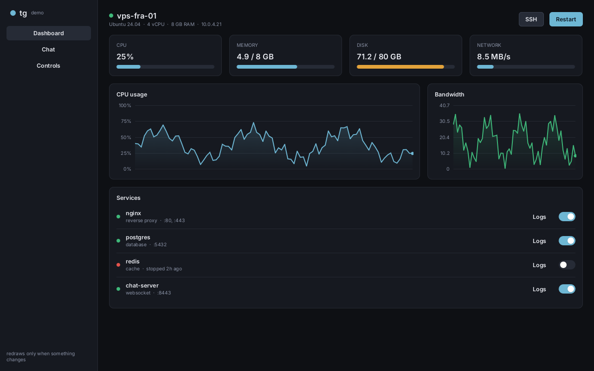
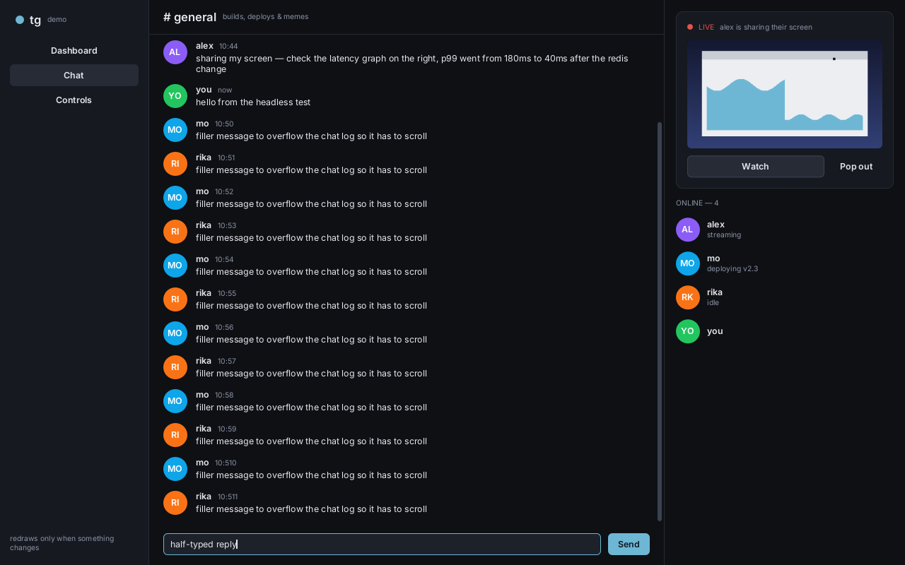
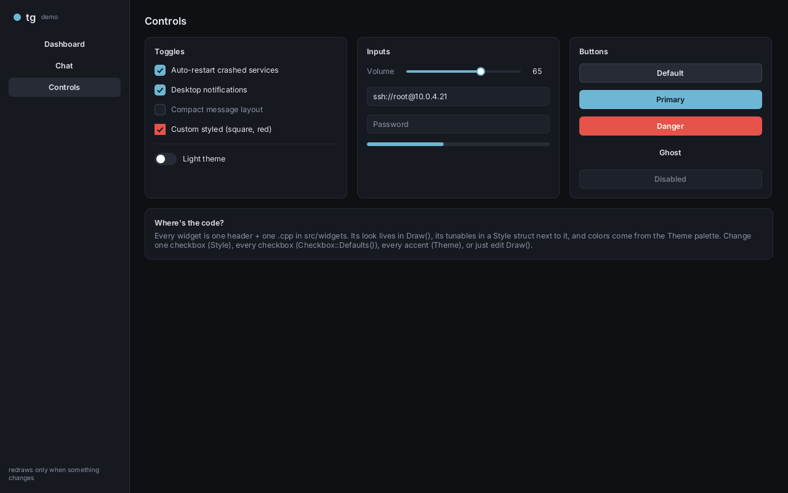
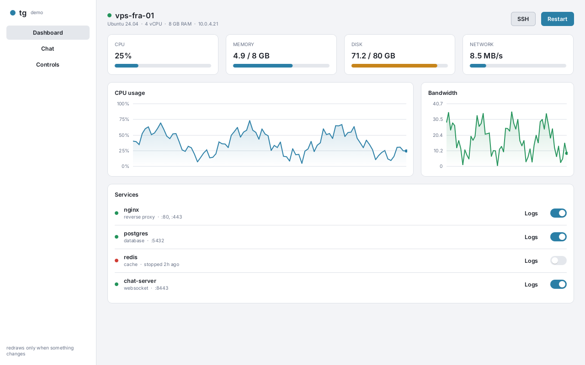

# tg

A small retained-mode C++20 GUI framework for real apps (chat clients with screen shares, server dashboards, tools), built so that **you can find and change anything in one place.**





| | |
|---|---|
|  |  |

These screenshots come from `tg_headless`, which renders with the built-in software rasterizer. The OpenGL backend produces the same pixels.

## Why it exists

ImGui is great, but restyling one checkbox means digging through a style system, a giant widgets file, and a pile of flags. tg aims for the opposite:

- **One widget = one header + one `.cpp`.** The checkbox is `include/tg/widgets/checkbox.h` (its `CheckboxStyle`) and `src/widgets/checkbox.cpp` (about 30 lines of `Draw()`, numbered top to bottom). To change how it looks, edit that file.
- **Retained, OOP widget tree**, like the old tgui `Window → Groupbox → Control`, but with real layout, ownership, and events.
- **Only redraws when something changes.** Nothing happens when idle. Animations, caret blink and posted data request exactly the frames they need.
- **Renderer-agnostic.** Widgets draw into a `DrawList` (textured triangles with anti-aliased edges). A backend implements five functions. OpenGL 3 and a CPU software renderer are included.
- **Fast to build.** The core is about 3k lines with no dependencies besides stb (vendored). A full rebuild of the core library takes about 9s on 4 cores (mostly stb_truetype). Editing a widget and relinking takes about 2s.

## Styling: four levels, pick the closest one

```cpp
// 1. Palette: every widget follows.
tg::GetTheme()[ tg::Tok::Accent ] = tg::Color::Hex( 0xFF4F81 );
tg::GetTheme().UseColors( tg::Theme::Light() );           // runtime theme switch

// 2. Per type: every checkbox created after this.
tg::Checkbox::Defaults().Radius = 0;

// 3. Per instance: just this one.
auto& Cb = Panel.Add<tg::Checkbox>( "Square & red", &MyBool );
Cb.Style.Radius = 0;
Cb.Style.Fill   = tg::Tok::Danger;             // a theme token...
Cb.Style.Check  = tg::Color( 255, 255, 255 );  // ...or a literal color

// 4. The code itself: open src/widgets/checkbox.cpp and change Draw(),
//    or subclass and override Draw().
```

Style colors are `Paint`s. A `Paint` is either a theme token (it follows theme changes) or a fixed `Color`.

## Building a UI

```cpp
#include "tg/tg.h"
using namespace tg;

auto& Card = Ctx.Root().Add<Box>( Dir::Column, /*gap*/ 10, /*padding*/ Insets( 16 ) );
Card.Style = Box::Card();

auto& Row = AddRow( Card, 8 );
Row.Add<Label>( "Volume" );
auto& Vol = Row.Add<Slider>( &Volume, 0, 100, /*step*/ 1 );
Vol.Layout.Width = Grow();                      // take the leftover space

Card.Add<Checkbox>( "Auto-restart", &AutoRestart );    // bind to your bool, like old tgui
Card.Add<Button>( "Deploy", [] { Deploy(); } ).Style = Button::Primary();

auto& Log = Card.Add<ScrollView>();
Log.StickToBottom = true;                        // chat / console behaviour
Log.Content().Add<Label>( "hello", /*wrap*/ true );
```

**Layout** is a small flexbox. `Dir::Column`, `Dir::Row` or `Dir::Stack`, plus `Gap`, `Padding`, `MainAlign` and `CrossAlign`. Each child sets its size per axis to `Fit()` (content size), `Px(n)` (fixed), or `Grow(weight)` (shares the leftover space).

**Threads.** Never touch widgets from another thread. Post instead:

```cpp
Ctx.Post( [&] { CpuChart->Push( Sample ); CpuLabel->SetText( Text ); } ); // safe from any thread, wakes the UI
```

**Live textures** (screen share, video, camera):

```cpp
TextureId Tex = Ctx.GetRenderer().CreateTexture( W, H, nullptr );
auto& View = Panel.Add<Image>( Tex, W, H );    // Style.Mode = Contain / Cover / Stretch
// per decoded frame (via Post):
Ctx.GetRenderer().UpdateTexture( Tex, W, H, Rgba ); View.Redraw();
```

## Writing a widget

Subclass `Widget`, then: set `Interactive = true` if it takes the mouse, override `Measure` if its size depends on content, `Draw` to paint, and `OnEvent` to react. The demo's `Avatar` is the whole thing:

```cpp
class Avatar : public tg::Widget {
public:
    Avatar( std::string I, tg::Color Bg ) : Initials( std::move( I ) ), Bg( Bg ) { Layout.Width = Px( 34 ); Layout.Height = Px( 34 ); }
    void Draw( tg::DrawList& D ) override {
        D.CircleFilled( Bounds.Center(), Bounds.w / 2, Bg );
        D.Text( *GetTheme().Bold, /*pos*/ ..., Initials, { 255, 255, 255 } );
    }
    std::string Initials; tg::Color Bg;
};
```

To animate, call `Animate( Value, Target )` inside `Draw`. It eases the value and keeps requesting frames until it settles. That replaces the global `CurAlpha[264]` arrays in the old checkbox.

## Layout of the repo

```
include/tg/            public headers
  core.h               Vec2, Rect, Color, Insets
  draw.h               DrawList: rects, rounded rects, strokes, circles, polylines, text, images, clipping
  font.h               stb_truetype atlas, UTF-8, wrapping
  theme.h              palette tokens, Paint, Theme::Dark()/Light()
  widget.h             Widget base + flex layout
  context.h            tree owner, input routing, focus, frame scheduling, Post()
  renderer.h           the 5-function backend interface
  widgets/*.h          Box, Label, Button, Checkbox, Toggle, Slider, ProgressBar, TextInput, ScrollView, Image, LineChart
src/                   implementations (one .cpp per widget)
backends/
  gl3_renderer.*       OpenGL 3.3 core, no loader lib needed
  glfw_platform.*      GLFW → tg input/cursor/clipboard/DPI + event-driven wait
  soft_renderer.*      CPU rasterizer → PNG (headless tests, screenshots)
examples/
  common/demo_ui.*     the demo app (dashboard, chat + screen share, controls)
  showcase/            GLFW + GL3 window; background threads feed data via Post()
  headless/            software-rendered run with scripted input + assertions (ctest)
assets/fonts/          Inter (OFL)
legacy-tgui-example/   the original DX9 tgui, kept for reference
```

## Build

Needs CMake 3.16+ and a C++20 compiler (MSVC 2019+, GCC 10+, Clang 12+). GLFW is used if it's installed. Otherwise CMake fetches it.

```sh
cmake -S . -B build -DCMAKE_BUILD_TYPE=Release
cmake --build build
./build/tg_showcase                 # the window
./build/tg_headless out/            # writes out/*.png and runs the checks
ctest --test-dir build
```

On Windows, `cmake -S . -B build -G "Visual Studio 17 2022"` and open `build/tg.sln`. Use `-DTG_BUILD_EXAMPLES=OFF` to build only the library and the headless test (no GLFW).

## Using a different renderer / platform

- **Renderer**: implement `tg::Renderer` (`CreateTexture`, `UpdateTexture`, `DestroyTexture`, `Render`). `Render` walks `DrawList::Cmds`. Each command is a scissor rect, a texture and an index range over `Vtx`/`Idx`. Vertex format: `float2 pos, float2 uv, rgba8 color`, straight-alpha blending. Read `backends/gl3_renderer.cpp` (about 200 lines) as the template.
- **Platform**: call `Ctx.OnMouseMove/OnMouseButton/OnMouseWheel/OnKey/OnText` and `Ctx.SetViewport(size, dpiScale)`. Then loop: `if (Ctx.NeedsFrame()) { Ctx.Frame(); Ctx.Render(fb); present(); } else wait(Ctx.SecondsUntilNextFrame());`. See `backends/glfw_platform.cpp`.

## Roadmap

Not built yet, roughly in priority order:

- [ ] Win32 + D3D11 backend (native Windows, no GLFW)
- [ ] Overlay layer: dropdown/combobox, tooltips, context menus, modals
- [ ] Virtualized list for very long chat histories (only measure and draw what's visible)
- [ ] Multi-line text area, word-wise caret movement, undo
- [ ] Keyboard navigation (Tab focus order), keybind widget (from old tgui)
- [ ] Font fallback (emoji / CJK) and dynamic glyph caching
- [ ] Tabs, split panes, tables
