# tg

A small retained-mode C++20 GUI framework for real apps (chat clients with screen shares, server dashboards, tools, overlays), built so that **you can find and change anything in one place**, and so that making a window with a checkbox takes about as much code as in ImGui.

```cpp
#include "tg/app.h"
#include <cstdio>

int main()
{
    tg::App App( "hello tg", 900, 600 );

    static bool Enabled = true;
    static float Volume = 0.5f;
    static int Quality = 1;
    static tg::Color Tint = tg::Color::Hex( 0x6EB7D4 );

    auto& W = App.Window( "Settings" );
    W.Checkbox( "Enabled", &Enabled );
    W.Slider( "Volume", &Volume, 0, 1 );
    W.Combo( "Quality", { "Low", "Medium", "High", "Ultra" }, &Quality );
    W.ColorPicker( "Tint", &Tint );
    W.Button( "Print", [] { std::printf( "volume=%.2f\n", Volume ); } );

    return App.Run();
}
```

That's the whole program. There are no asset files to ship, because the font is compiled into the library. (`examples/hello` is the old tgui README example ported to tg, shown further down.)

## Documentation

Full guide in [`docs/`](docs/README.md):

| | |
|---|---|
| [Getting started](docs/getting-started.md) | build, run the examples, add tg to your project |
| [Core concepts](docs/concepts.md) | the widget tree, frame loop, input, popups, threads |
| [Layout](docs/layout.md) | rows / columns / stacks, `Fit` / `Px` / `Grow` |
| [Styling](docs/styling.md) | theme, per-type and per-instance styles, editing `Draw()` |
| [Controls reference](docs/widgets.md) | every widget and its API |
| [App systems](docs/systems.md) | keyboard navigation, shortcuts, undo, profiles, inspector |
| [Writing widgets](docs/custom-widgets.md) | subclassing, `DrawList`, events, animation |
| [Platforms & renderers](docs/backends.md) | `tg::App`, Win32 + D3D11/9, GLFW + GL3, overlays |
| [Testing](docs/testing.md) | the headless test, scripted input, Wine |

## Screenshots

These come from `tg_headless`, which renders with the built-in software rasterizer. The OpenGL backend produces the same pixels.


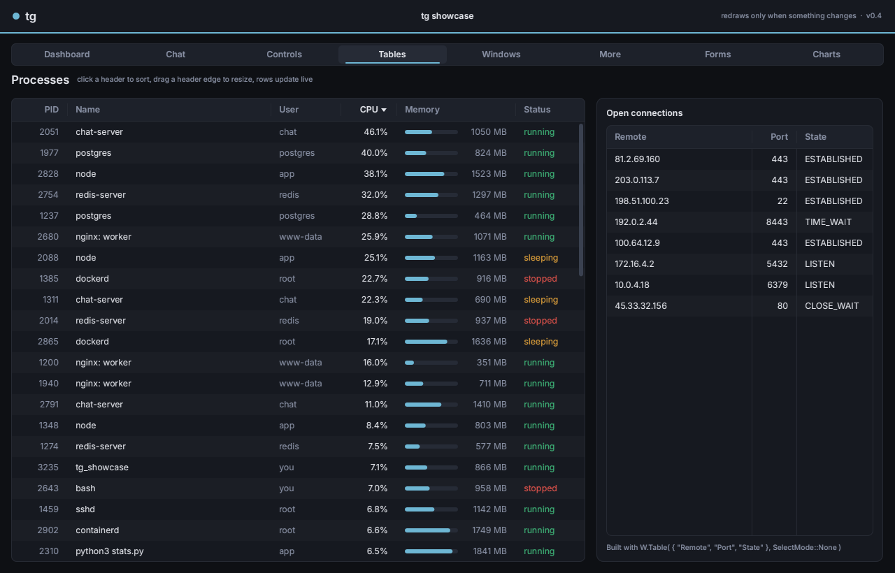

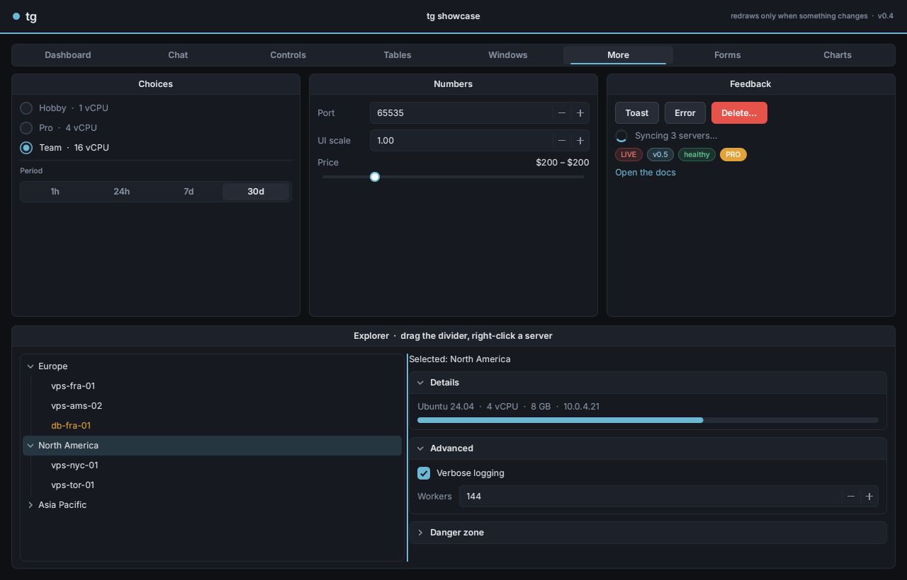

| | |
|---|---|
| 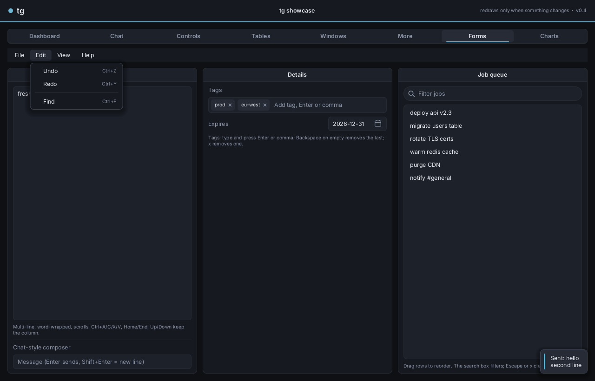 | 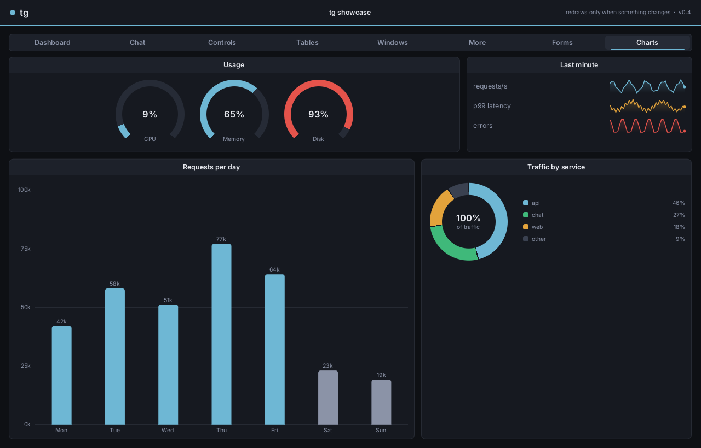 |
| 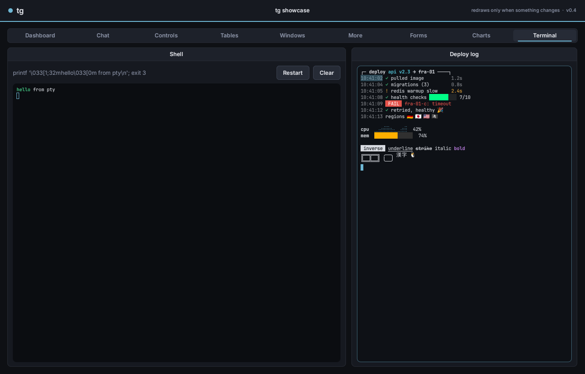 | 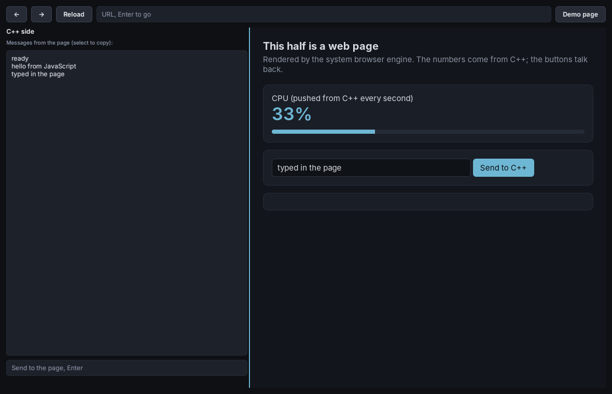 |

| | |
|---|---|
|  | 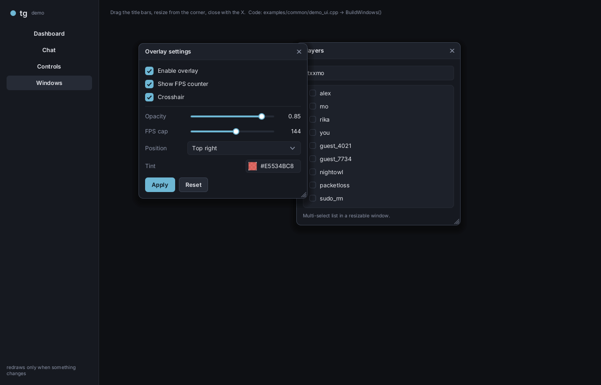 |
|  | 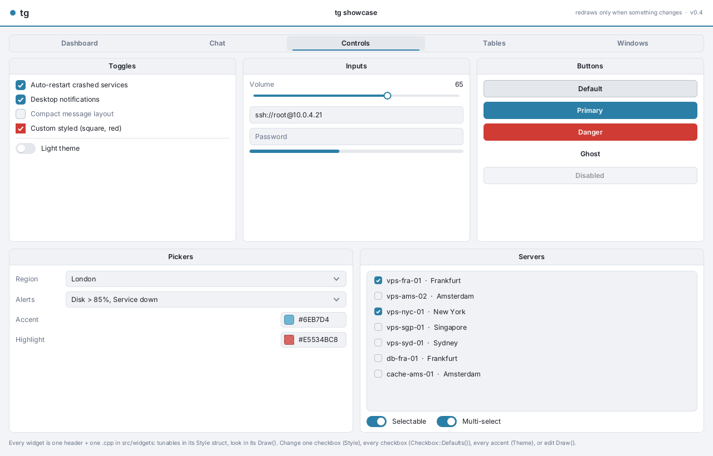 |
| 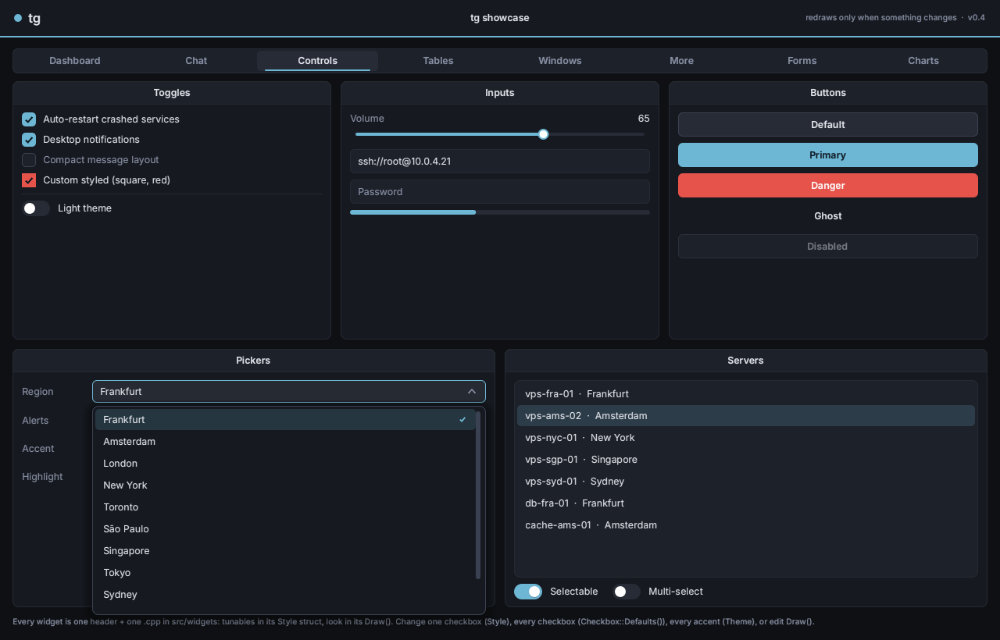 | 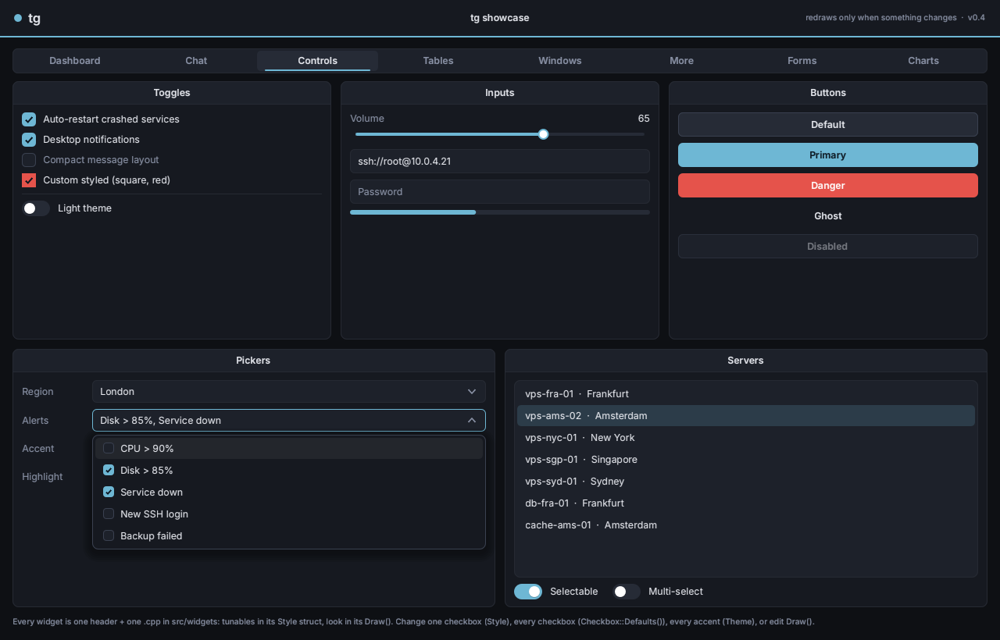 |
| 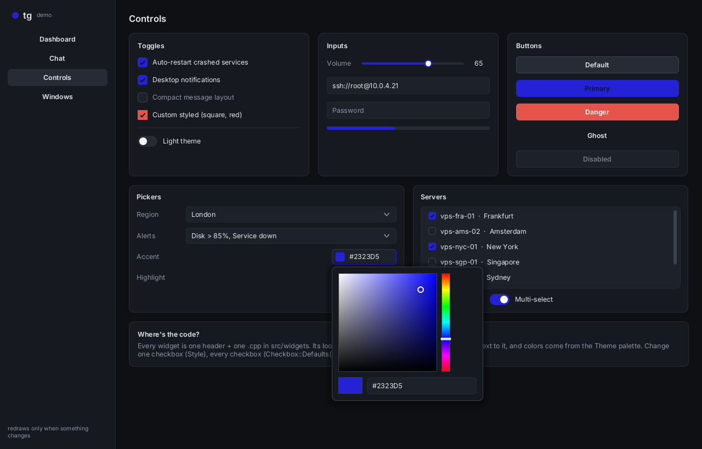 | |

## Use it in your project

**CMake, via FetchContent:**

```cmake
include( FetchContent )
FetchContent_Declare( tg GIT_REPOSITORY https://github.com/thugexchange/tg.git GIT_TAG main )
FetchContent_MakeAvailable( tg )

add_executable( myapp main.cpp )
target_link_libraries( myapp PRIVATE tg::app )   # tg::app = tg + GLFW + OpenGL 3 + tg::App
```

You can also copy the repo in and use `add_subdirectory( tg )`. When tg is pulled in this way, its examples are off by default. GLFW is used if it's installed. Otherwise CMake fetches it.

**Targets:**

| target | what | deps |
|---|---|---|
| `tg::tg` | widgets, layout, text, DrawList, terminal + pty | none (stb is vendored); FreeType with `-DTG_FREETYPE=ON` (color emoji); HarfBuzz with `-DTG_HARFBUZZ=ON` (flags, ZWJ sequences, skin tones) |
| `tg::app` | `tg::App`: window + renderer + event loop | Windows: Win32 + Direct3D 11 (default). Elsewhere: GLFW + OpenGL 3.3 |
| `tg::win32` | Win32 messages → tg input, DPI, cursor, clipboard | Windows |
| `tg::d3d11` | Direct3D 11 renderer | Windows |
| `tg::d3d9` | Direct3D 9 renderer (DX9 hosts, like the old tgui) | Windows |
| `tg::soft` | software renderer → PNG (tests, screenshots) | none |
| `tg::webview` | `tg::WebView` (with `-DTG_WEBVIEW=ON`) | Windows: WebView2 (SDK fetched). Linux: WebKitGTK. macOS: WebKit |

`-DTG_APP_BACKEND=glfw` makes `tg::App` use GLFW + OpenGL on Windows too.

To use your own window or renderer (Win32, SDL, D3D11, an existing game engine), link just `tg::tg` and see [Bring your own platform/renderer](#bring-your-own-platform--renderer).

## tgui-style layout: window, tabs, groupboxes

The old tgui organisation (a window with tabs across the top and titled groupboxes side by side) is built in:

```cpp
auto& W = App.Window( "Test Window", { 40, 40 }, { 440, 320 } );
W.Chrome = tg::Window::Classic();      // centered title + accent line
W.Footer = "v.2.5";

auto& Tab1 = W.Tab( "Tab 1" );         // tabs appear on first use; switching cross-fades
W.Tab( "Tab 2" );

auto& Groups = Tab1.Columns();         // full-height row
auto& G = Groups.Group( "Example Group" );   // titled frame, scrolls when it overflows
G.Checkbox( "Checkbox", &BooleanEx );
G.Slider( "Slider float", &SliderEx, 0, 100 );
G.Combo( "", { "Item 1", "Item 2", "Item 3" }, &iComboEx );
Groups.Group( "Example Group 2" ).Button( "Print", [] { ... } );
```

`Tab()`, `Columns()` and `Group()` work on any Container (windows, cards, the main area), so the same shape works for a full app. The showcase's top-level menu is the same `Tab()` strip.

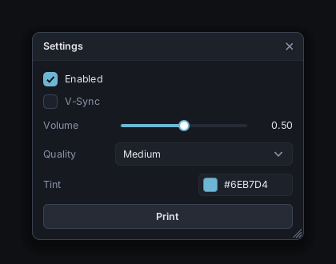

## Controls

| widget | one-liner (`Container` helper) | notes |
|---|---|---|
| Label | `W.Text( "hi" )`, `W.Heading(..)`, `W.Caption(..)` | wrapping |
| Button | `W.Button( "Go", [] { ... } )` | `Button::Primary() / Danger() / Ghost()` styles |
| Checkbox | `W.Checkbox( "Enabled", &b )` | bind to your `bool`, or `OnChange` |
| Toggle | `W.Toggle( "Dark mode", &b )` | switch |
| Slider | `W.Slider( "Volume", &f, 0, 1 )`, `W.SliderInt( "FPS", &i, 30, 240 )` | label + slider + value |
| TextInput | `W.Input( "Nickname", &str )` | selection, clipboard, password mode |
| Combo | `W.Combo( "Region", items, &index )` | dropdown, scrolls when long |
| MultiCombo | `W.MultiCombo( "Alerts", items, &vectorOfBool )` | checkboxes in the dropdown; shows "a, b" or "3 selected" |
| ListBox | `W.List( items, SelectMode::Single, &index )` | `SelectMode::None` = plain list, `Single`, `Multi`; switch live with `SetMode()` |
| ColorPicker | `W.ColorPicker( "Tint", &color )` | swatch → popup: SV square, hue, alpha, hex input |
| ColorPanel | `W.ColorPanel( &color )` | the picker, inline |
| RadioGroup / Segmented | `W.Radio( opts, &i )`, `W.Segmented( opts, &i )` | pick one of a few |
| NumberInput | `W.Number( "Scale", &f, 0, 4, 0.25f )`, `W.NumberInt( "Port", &i, 1, 65535 )` | type, -/+, Up/Down (Shift x10); validates and clamps |
| RangeSlider | `W.Range( "Price", &lo, &hi, 0, 1000 )` | two knobs |
| TreeView | `W.Tree().Add( "Europe" ).Add( "vps-fra-01" )` | expand/collapse, select, keyboard, scrolls |
| Collapsible | `W.Collapsible( "Advanced", &open )` | animated accordion section (a Container) |
| Splitter | `W.Split( tg::Dir::Row, 0.3f )` | two resizable panes |
| TextArea | `W.TextArea( "Notes", &str )` | multi-line, wrap, scroll; chat mode: Enter sends, grows to `MaxLines` |
| MenuBar | `W.MenuBar().Add( "File", []( tg::Menu& M ) { ... } )` | File / Edit / View menus, hover to switch |
| SearchBox | `W.Search( "Filter", &str )` | magnifier, clear button, Escape clears |
| TagInput | `W.Tags( &vec, "Add tag" )` | chips; Enter / comma adds, x / Backspace removes |
| DatePicker | `W.Date( "Expires", &date )` | calendar popup |
| Charts | `W.BarChart()`, `W.Donut()`, `W.Gauge( "CPU", v )`, `W.Sparkline()` | animated, hover details |
| Terminal | `W.Terminal().Spawn()` | VT/xterm emulator: your shell or any command in a pty (ConPTY on Windows), or `Write()` bytes from SSH / websockets; 256 + truecolor, alt screen, scrollback, selection, emoji + CJK, mouse reporting (vim/htop/tmux), double/triple-click select, middle-click / Shift+Insert paste |
| WebView | `Pane.Add<tg::WebView>( url )` | web pages in your UI (WebView2 / WebKitGTK); `tg.post()` / `tg.on()` bridge to C++; `-DTG_WEBVIEW=ON` |
| Copy & paste | `Label.SetSelectable( true )` | selectable chat/log text, right-click Cut/Copy/Paste in text fields, Ctrl+C on table rows (TSV) |
| Drag to reorder | `List.Reorderable = true` | ListBox rows |
| Tooltip | `AnyWidget.Tooltip = "..."` | on every widget, labels too |
| Context menu | `AnyWidget.ContextMenu = []( tg::Menu& M ) { ... }` | right-click; items, checks, shortcuts, separators |
| Dialog | `tg::Confirm( Ctx, title, msg, { "Cancel", "Delete" }, fn )` | modal; Enter / Escape; custom bodies via `OpenDialog` |
| Toast | `tg::Toast( Ctx, "Saved", tg::Tok::Success )` | notifications that fade out |
| Spinner / Badge / Link | `W.Spinner()`, `W.Badge( "LIVE", tg::Tok::Danger )`, `W.Link( "docs", fn )` | |
| Key binds on anything | right-click a control → **Add key bind** | hold / toggle / off hold / press; checkbox on/off, slider value, combo option, multicombo items, color, button click; `Ctx.Binds.Save()` / `Load()` |
| Keybind | `W.Keybind( "Aim key", &key )` | click, press any key or mouse button (incl. side buttons); Escape unbinds; right-click for hold / toggle / always; `IsActive()` |
| ProgressBar | `W.Progress( 0.4f )` | optional warn/hot thresholds |
| Table | `W.Table( { "Name", "CPU", "Memory" } )` | sortable headers (numbers sort as numbers), drag-to-resize columns, None/Single/Multi row select, custom cells, only visible rows drawn |
| Window | `App.Window( "Title", pos, size )` | drag, resize, close, raise on click; `Window::Classic()` look |
| TabView | `W.Tab( "Name" )` | equal-width tab strip, sliding highlight, cross-fade, optional `int*` bind |
| Groupbox | `Cols.Group( "Title" )` | titled frame, scrolls its own contents |
| ScrollView, Image, LineChart, Box | `Add<T>(...)` | chat logs, live textures/screen share, charts, cards |

Layout helpers: `W.Row()`, `W.Column()`, `W.Card( "Title" )`, `W.Separator()`, `W.Spacer()`. They return Containers, so the helpers chain:

```cpp
auto& Btns = W.Row();
Btns.Button( "Apply" ).Style = tg::Button::Primary();
Btns.Button( "Reset" );
```

Every helper returns the real widget, so you can keep going: `W.Checkbox( "x", &b ).Style.Radius = 0;`.

## Styling: four levels, pick the closest one

```cpp
// 1. Palette: every widget follows.
tg::GetTheme()[ tg::Tok::Accent ] = tg::Color::Hex( 0xFF4F81 );
tg::GetTheme().UseColors( tg::Theme::Light() );           // runtime theme switch

// 2. Per type: every checkbox created after this.
tg::Checkbox::Defaults().Radius = 0;

// 3. Per instance: just this one.
auto& Cb = W.Checkbox( "Square & red", &MyBool );
Cb.Style.Radius = 0;
Cb.Style.Fill   = tg::Tok::Danger;             // a theme token...
Cb.Style.Check  = tg::Color( 255, 255, 255 );  // ...or a literal color

// 4. The code itself: open src/widgets/checkbox.cpp and change Draw(),
//    or subclass and override Draw().
```

Each widget is one header plus one `.cpp`. Its tunables are a `XxxStyle` struct at the top of the header, and its whole look is the `Draw()` function in its `.cpp`. Style colors are `Paint`s. A `Paint` is either a theme token (it follows theme changes) or a fixed `Color`.

## How it works (the 60-second version)

- **Retained tree.** You build widgets once, keep references to the ones you care about, and change them when data changes. This is the same model as the old tgui `Window → Groupbox → Control`, but with ownership, layout and events.
- **Flex layout.** `Dir::Column / Row / Stack / Free`, plus `Gap`, `Padding` and alignment. Each child sizes itself per axis with `Fit()`, `Px(n)` or `Grow(weight)`. `Dir::Free` places children at `Layout.Offset`, which is how floating windows work.
- **Redraws only on change.** An idle window does nothing. Animations (`Animate(value, target)` inside `Draw`) and the caret blink request exactly the frames they need. If you're making a game overlay, use `AppConfig::Continuous` to redraw every frame.
- **Popups** (dropdowns, pickers) live on an overlay layer drawn above everything. They close on an outside click or Escape.
- **Threads.** Never touch widgets from another thread. Post instead: `Ctx.Post( [&] { Chart->Push( Sample ); } );`. It's safe from any thread and wakes the UI.
- **Live textures** (screen share, video): `CreateTexture` once, `UpdateTexture` per frame, and show it with an `Image` widget.

## Tables

```cpp
auto& T = W.Table( { "PID", "Name", "CPU", "Status" } );
T.Column( 0 ).Width = tg::Px( 80 );
T.Column( 2 ).TextAlign = tg::Align::End;
T.AddRow( { "1234", "nginx", "3.2%", "running" } );
T.SortBy( 2, /*ascending*/ false );
T.SetCell( row, 2, "4.0%" );                    // live updates re-sort automatically
T.CellColor = [&]( size_t Row, size_t Col, tg::Color& Out ) { ... return true; };  // e.g. red "stopped"
T.DrawCell  = [&]( tg::DrawList& D, tg::Rect Cell, size_t Row, size_t Col ) { ... return true; }; // bars, icons
```

Row numbers are stable: sorting changes the display order, not the indices you use for `SetCell`, selection or `Bind`. Rows are painted directly instead of being widgets, and only the visible ones are drawn. With 100k rows, a scroll frame takes about 0.04 ms and a full re-sort about 0.1 s.

## Keys and hotkeys

```cpp
static tg::Key AimKey = tg::Key::Mouse5;
auto& Aim = W.Keybind( "Aim key", &AimKey );      // bound to your tg::Key, like tgui's int*
if ( Aim.IsActive() ) { ... }                       // respects hold / toggle / always

Ctx.IsKeyDown( tg::Key::LeftShift );                // poll any key or mouse button
Ctx.OnKeyEvent = [&]( tg::Key K, bool Down ) {      // global hotkeys, e.g. Insert toggles the menu
    if ( Down && K == MenuKey ) { Menu.Visible ? Menu.Close() : Menu.Show(); return true; }
    return false;
};
```

`tg::Key` covers the full keyboard (letters, digits, F1–F24, keypad, modifiers, punctuation) plus `Mouse1`–`Mouse5`. `tg::KeyName()` gives display names like `F5`, `LSHIFT` and `MOUSE4`. The hotkey hook doesn't fire while a Keybind is listening or while you're typing in a text field.

## Writing a widget

Subclass `Widget`. Set `Interactive = true` if it takes the mouse. Override `Measure` if its size depends on content, `Draw` to paint, and `OnEvent` to react. For example, the demo's avatar:

```cpp
class Avatar : public tg::Widget {
public:
    Avatar( std::string I, tg::Color Bg ) : Initials( std::move( I ) ), Bg( Bg ) { Layout.Width = tg::Px( 34 ); Layout.Height = tg::Px( 34 ); }
    void Draw( tg::DrawList& D ) override {
        D.CircleFilled( Bounds.Center(), Bounds.w / 2, Bg );
        D.Text( *tg::GetTheme().Bold, /*pos*/ ..., Initials, { 255, 255, 255 } );
    }
    std::string Initials; tg::Color Bg;
};
```

`DrawList` gives you anti-aliased rects and rounded rects (fill, stroke, gradient, per-corner color), circles, polylines, text, images, clipping and shadows. To build a new dropdown-style picker, subclass `DropdownBase` (see `combo.h`). For any other floating panel, call `tg::OpenPopup( *this, Bounds )`.

## Repo layout

```
include/tg/            public headers (tg.h = everything, app.h = tg::App)
  core.h draw.h font.h theme.h widget.h context.h renderer.h input.h
  widgets/*.h          one header per widget
src/                   one .cpp per header; default_fonts.cpp = embedded Inter (generated by tools/embed_fonts.py)
backends/
  app.cpp              tg::App on GLFW + GL3
  app_win32.cpp        tg::App on Win32 + Direct3D 11
  win32_platform.*     Win32 messages → tg input / cursor / clipboard / DPI
  d3d11_renderer.*     Direct3D 11 renderer (state save/restore: overlay-safe)
  d3d9_renderer.*      Direct3D 9 renderer
  gl3_renderer.*       OpenGL 3.3 core renderer, no loader library needed
  glfw_platform.*      GLFW → tg input / cursor / clipboard / DPI, event-driven wait
  soft_renderer.*      CPU rasterizer → PNG
examples/
  hello/               the snippet at the top of this README
  showcase/            full demo: dashboard, chat + screen share, controls, floating windows
  headless/            same demo, software-rendered, scripted input + assertions (ctest)
  win32_d3d11/         your own Win32 window + D3D11 device, tg menu on top (overlay shape)
  win32_d3d9/          same with Direct3D 9, like the old tgui
assets/fonts/          Inter (OFL) source files
legacy-tgui-example/   the original DX9 tgui, kept for reference
```

## Build the examples

You need CMake 3.16+ and a C++20 compiler (MSVC 2019+, GCC 10+, or Clang 12+).

```sh
cmake -S . -B build -DCMAKE_BUILD_TYPE=Release
cmake --build build
./build/tg_hello
./build/tg_showcase
./build/tg_headless out/       # writes out/*.png and runs the checks
ctest --test-dir build
```

On Windows, run `cmake -S . -B build -G "Visual Studio 17 2022"` and open `build/tg.sln`.

**Build speed:** a full rebuild of the core library takes about 9s on 4 cores, most of it stb_truetype. Editing a widget and relinking takes about 2s.

## Windows: Win32 + DirectX

On Windows, `tg::App` is native: a Win32 window and a Direct3D 11 device, with no GLFW. The same `App` code from the hello example builds unchanged.

To put tg inside a window and device you already have (a game, an overlay, an existing D3D app), use the backends directly. This is the shape of `examples/win32_d3d11` and `examples/win32_d3d9`:

```cpp
// setup, once
tg::D3D11Renderer Dx;  Dx.Init( Device, DeviceContext );     // or tg::D3D9Renderer Dx; Dx.Init( Device9 );
tg::Context Ctx( Dx );
Ctx.LoadDefaultFonts( tg::win32::GetDpiScale( Hwnd ) );
tg::win32::Install( Hwnd, Ctx );
BuildMyMenu( Ctx );                                       // Windows, tabs, groupboxes...

// your WndProc
if ( tg::win32::HandleMessage( Hwnd, Msg, WParam, LParam ) ) { /* tg used it: an overlay can hide it from the game */ }

// your frame (DX9: between BeginScene / EndScene)
tg::win32::Sync( Hwnd, Ctx );
Ctx.Frame();
Ctx.Render( { BackBufferWidth, BackBufferHeight } );
```

- Both renderers save and restore the device state they touch, so drawing tg on top doesn't disturb the host's rendering.
- On DX9, call `Dx.InvalidateDeviceObjects()` before `IDirect3DDevice9::Reset` and `Dx.CreateDeviceObjects()` after it.
- `HandleMessage` returns true when the input belongs to tg (mouse over a tg widget, a text field or keybind with focus).
- The examples bind Insert to show and hide the menu, like the old tgui.

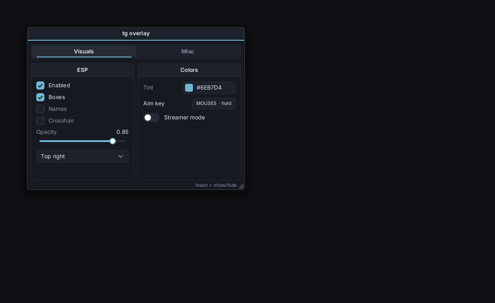

*`examples/win32_d3d9`: the menu drawn into a host's own Direct3D 9 frame (running under Wine).*

**Cross-compiling from Linux:** `cmake -S . -B build-win -DCMAKE_TOOLCHAIN_FILE=cmake/mingw-w64.cmake` produces static .exes. All of the Windows builds in this repo have been run under Wine (D3D11 and D3D9).

## Bring your own platform / renderer

- **Renderer:** implement `tg::Renderer`, which has four functions: `CreateTexture`, `UpdateTexture`, `DestroyTexture` and `Render`. `Render` walks `DrawList::Cmds`; each command is a scissor rect, a texture and an index range over `Vtx`/`Idx`. The vertex format is `float2 pos, float2 uv, rgba8 color`, with straight-alpha blending. `backends/gl3_renderer.cpp` (about 220 lines) is the template.
- **Platform:** feed `Ctx.OnMouseMove / OnMouseButton / OnMouseWheel / OnKey / OnText` and `Ctx.SetViewport( size, dpiScale )`. Then loop: `if ( Ctx.NeedsFrame() ) { Ctx.Frame(); Ctx.Render( fb ); present(); } else wait( Ctx.SecondsUntilNextFrame() );`. `backends/glfw_platform.cpp` is the template.

## Roadmap

- [x] Win32 + D3D11 backend (native Windows, no GLFW), D3D9 renderer
- [ ] Metal for macOS, D3D12 / Vulkan renderers
- [ ] Single-header + single-.cpp bundle for copy-in use without CMake
- [ ] Tooltips, context menus, modal dialogs (the popup layer is in place)
- [ ] Keyboard navigation (Tab focus order, arrow keys in lists/combos), keybind widget from old tgui
- [ ] Virtualized lists for very long chat histories
- [ ] Multi-line text area, word-wise caret movement, undo
- [ ] Font fallback (emoji / CJK), IME
- [ ] Tabs, split panes
- [ ] Table: editable cells, column reordering, keyboard row navigation
