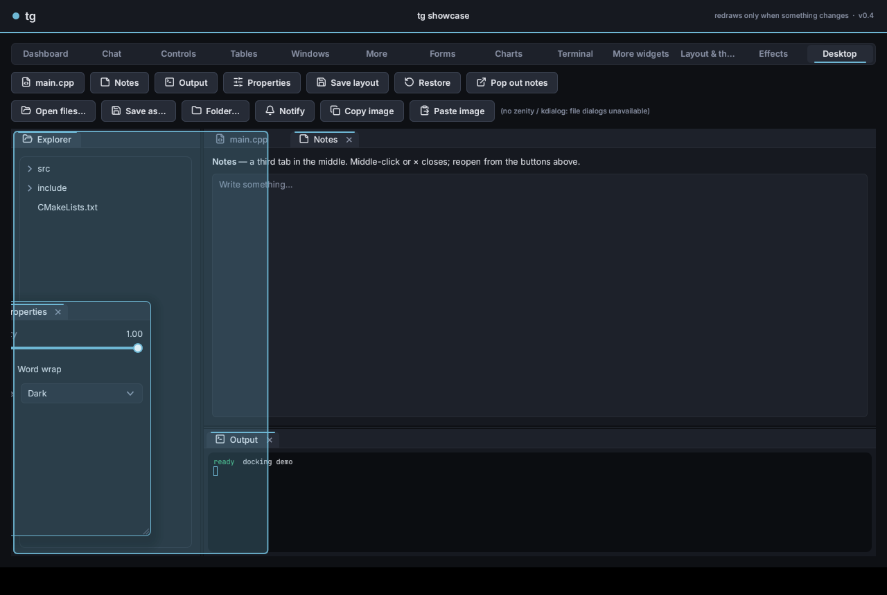
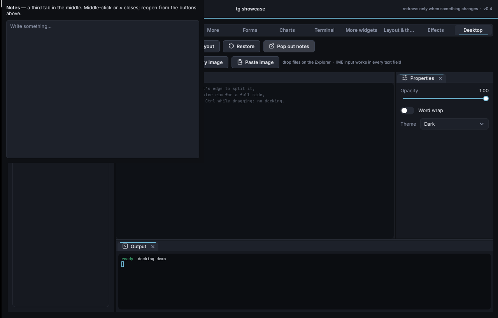

# Desktop integration

This page covers docking panels, files dragged in from the OS, IME input, native file dialogs, notifications, the tray icon, extra OS windows (and popping widgets out into them), and images on the clipboard.

The showcase's **Desktop** tab demos all of it (`tg_showcase --tab 12`).



## Docking: `DockSpace`

`tg/widgets/dock.h`. IDE-style panels: tabs inside a tree of splits.

```cpp
auto& Dock  = Page.Dock();                                  // or Page.Add<tg::DockSpace>()
auto& Files = Dock.AddPanel( "Files", "files" );            // DockPanel is a Container: all the helpers work
auto& Code  = Dock.AddPanel( "Editor", "editor" );
auto& Log   = Dock.AddPanel( "Log", "log" );
Dock.Dock( Files, &Code, tg::DockSide::Left, 0.25f );       // left of the editor, 25% wide
Dock.Dock( Log, &Code, tg::DockSide::Bottom, 0.3f );
Files.Tree() ...;  Log.Terminal() ...;
```

What the user can do with the mouse:

| Action | Result |
|---|---|
| Click a tab | Brings it to the front. |
| Drag a tab along its strip | Reorders the tabs. |
| Drag a tab off the strip | It floats under the cursor. Hover another panel to see where it will land, from the preview and the compass in the middle. **Centre** adds it as a tab. **An edge** splits that panel. **The space's outer rim** docks it along that whole side. |
| Hold **Ctrl** while dragging | Just moves the floating window; it won't dock. |
| Drag a floating window's title | Moves it. Dropping it on a panel docks it, the same as dragging a tab. |
| Drag the corner grip | Resizes a floating window. |
| Double-click a floating title | Docks it back. |
| Drag a divider | Resizes a split. |
| Middle-click a tab, or its **×** | Closes it (only when `Closable`). `Show( P )` reopens it where it was. |

API:

| | |
|---|---|
| `AddPanel( Title, Id )` | New panel, added as a tab next to the last one. `Id` is used for saving; it defaults to the title. |
| `Dock( P, Target, Side, Ratio )` | Moves P next to `Target`; `nullptr` means the whole space. `Center` adds it as a tab; any other side splits, with P taking `Ratio`. |
| `Float( P, Rect )` | Pops P out into a floating window, in DockSpace coordinates. |
| `Close( P )`, `Show( P )`, `IsOpen( P )` | Close or reopen a panel. A closed panel stays owned by the DockSpace and remembers where it was. |
| `Activate( P )`, `IsFloating( P )`, `Find( Id )`, `Panels()`, `TabOf( P )` | |
| `SaveLayout()` / `LoadLayout( S )` | The arrangement as a short string. Unknown ids are skipped, panels missing from the string get closed, and a malformed string is rejected without changing anything. |
| `OnLayoutChange` | Called after any drag, drop, resize or close by the user. Save the layout here. |
| `DockPanel::Closable`, `OnClose` | |
| `Style` (`DockStyle`) | Tab height, padding, colours, rim size and so on. |

A layout string looks like this:

```
split(row,0.25,tabs(files|0),split(col,0.7,tabs(editor,notes|0),tabs(log|0)));float(40,40,300,200,tabs(props|0))
```

## Files dragged in from the OS

Files dropped from Explorer, Finder or a file manager arrive as an ordinary tg drop with `Type == "files"`. The paths are in `DragData::Paths`.

```cpp
Zone.AcceptDrop = []( const tg::DragData& D ) { return D.Type == "files"; };
Zone.OnDrop = [&]( const tg::DragData& D, tg::Vec2 ) { for ( auto& Path : D.Paths ) Open( Path ); };
Ctx.OnFiles = [&]( const std::vector<std::string>& Paths, tg::Vec2 ) { ... }; // when no widget took them
```

- **Windows:** an OLE drop target. While files hover over the window, the widget that would take them is highlighted and a label shows the file name or "N files". If OLE can't start on the thread, it falls back to `WM_DROPFILES`.
- **GLFW** (Linux, macOS): `glfwSetDropCallback`. GLFW only reports the drop, so there's no hover highlight.
- **Your own platform layer:** call `Ctx.OnFilesOver( Pos, Paths )` while the drag moves, `OnFilesLeave()` when it leaves, and `OnFilesDrop( Pos, Paths )` on release.

## IME (Chinese, Japanese, Korean ... input)

Text widgets report their caret through `Widget::CaretRect()`. `TextInput`, `TextArea`, `CodeEditor` and `Terminal` already do this. The platform passes the text being composed to `Ctx.OnComposition( Text, CursorBytes )`, and tg draws it underlined at the caret. The committed text then arrives as normal `OnText`.

- **Windows:** handled in `win32::HandleMessage` (`WM_IME_*`). The candidate list follows the caret and the system composition window is hidden.
  - If you use your own WndProc, return 0 for `WM_IME_STARTCOMPOSITION`, `WM_IME_COMPOSITION` and `WM_IME_ENDCOMPOSITION` when `HandleMessage` returns true, the way `tg::App` does.
- **GLFW:** the committed characters arrive through the char callback, so CJK input works. GLFW has no pre-edit API, so the IME shows its own composition window.

## `tg/os.h`: dialogs, notifications, links, clipboard images

```cpp
auto Paths = tg::os::OpenFiles( { "Open images", { { "Images", "*.png;*.jpg" } } } ); // blocking; empty = cancelled
std::string Out = tg::os::SaveFile( { "Export", { { "CSV", "*.csv" } }, {}, "report.csv" } );
std::string Dir = tg::os::PickFolder( { "Pick a folder" } );

// non-blocking: the dialog runs on a worker thread, the callback runs on the UI thread
tg::os::FileDialog D{ "Open logs", { { "Logs", "*.log" } } };
D.Multiple = true;
D.Owner = Ctx.NativeWindow;  // modal over your window
tg::os::OpenFilesAsync( Ctx, D, [&]( std::vector<std::string> P ) { ... } );

tg::os::Notify( "Backup finished", "142 files" );
tg::os::OpenUrl( "https://example.com" );     // or a file / folder in its default app

tg::Bitmap Img;
if ( tg::os::GetClipboardImage( Img ) ) { ... Img.Width, Img.Height, Img.Pixels (RGBA) }
tg::os::SetClipboardImage( Img );
```

| | Windows | Linux | macOS |
|---|---|---|---|
| File dialogs | `IFileOpenDialog` / `IFileSaveDialog` | `zenity`, or `kdialog` if zenity is missing. `DialogsAvailable()` is false when neither is installed | `osascript` |
| Notifications | tray balloon / toast | `notify-send`, or `gdbus` if it's missing | `osascript` |
| `OpenUrl` | `ShellExecute` | `xdg-open` | `open` |
| Clipboard images | `CF_DIB` | `wl-paste` / `wl-copy` (Wayland) or `xclip` (X11), as PNG | not yet (returns false) |
| Tray icon | yes | no (`Supported()` is false) | no |

Helper programs on Linux are run directly with `posix_spawn`, without a shell, so file names and titles can't inject commands.

## Tray icon

```cpp
tg::TrayIcon Tray( "My app" );                 // optional 2nd argument: a tg::Bitmap icon (default: the exe's icon)
Tray.Items = { { "Show", [&] { ... } }, {}, { "Quit", [&] { App.Quit(); } } };  // {} = separator
Tray.OnClick = [&] { ... };                    // left click
Tray.Balloon( "Done", "Export finished" );     // a notification from the icon
```

On Windows this is `Shell_NotifyIcon` with a native menu, and it re-adds itself if Explorer restarts. On other systems `TrayIcon::Supported()` is false and the object does nothing, except that `Balloon` falls back to `os::Notify`. A Linux tray needs a StatusNotifierItem D-Bus service, which isn't built in yet.

## Extra OS windows and pop-out



```cpp
auto& W = App.NewWindow( "Inspector", 420, 600 );   // own Main() area, Context, popups, floating windows
W.Main().Heading( "Inspector" );
W.OnClose = [] { ... };

auto& Out = App.PopOut( SomePanel, "Notes" );       // move a widget (and everything under it) into its own window
// closing that window puts SomePanel back at the same spot in its old parent
```

- Every window shares the fonts and the theme.
  - **Win32 + D3D11:** all windows use one device and renderer; each has its own swapchain.
  - **GLFW + GL3:** the GL contexts are shared, and each window has its own `GL3Renderer` and its own copy of the glyph atlas texture, updated whenever the atlas changes.
- Only the main window waits for vsync, so two windows don't halve the frame rate.
- To pop out a docked panel, `Close` it in the DockSpace first. When it comes back, `Show` it again. Do the `Show` with `Ctx.Post` from `OnClose`, because the widget is put back right after `OnClose` returns. The showcase does exactly this:

```cpp
Dock.Close( P );
auto& W = App.PopOut( P, "Notes", 520, 420 );
W.OnClose = [&, Pp = &P] { Ctx.Post( [&, Pp] { Dock.Show( *Pp ); } ); };
```

Without `tg::App`:
- **Second window:** construct `tg::Context Second( ItsRenderer, MainCtx )`. That context draws with `MainCtx`'s fonts, and `MainCtx` must outlive it.
- **Win32:** `win32::Install` works for any number of windows. Call `win32::Uninstall( Hwnd )` before destroying one.
- **Moving a widget between trees:** `Widget::Detach( Child )` takes a child out without destroying it, so you can `AddChild` it somewhere else.

Limits:
- A second window uses the main window's DPI for its text, so on a monitor with a different scale its text is resampled.
- Don't destroy a popped-out widget's old parent while it's out, because it needs that parent to come back to.
