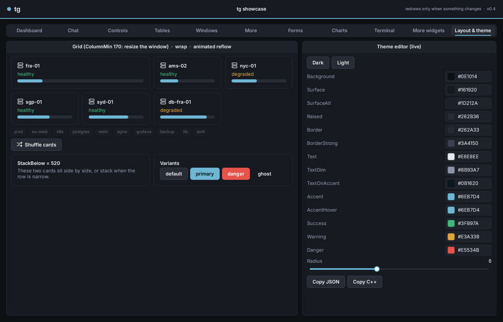

# Layout

Every widget has a `Layout` (a `tg::LayoutSpec`). A widget positions its children with a small flexbox. You rarely set coordinates by hand.

```cpp
struct LayoutSpec
{
    Dir Direction = Dir::Column;     // how children are arranged
    Size Width, Height;              // how big *this* widget wants to be (default Fit)
    Insets Padding;                  // space inside the edges
    float Gap = 0;                   // space between children
    Align MainAlign = Align::Start;  // along Direction
    Align CrossAlign = Align::Stretch; // across Direction
    float MinWidth = 0, MinHeight = 0;
    Vec2 Offset;                     // position inside a Dir::Free parent
};
```

## Directions

| `Dir` | Children are... | Typical use |
|---|---|---|
| `Column` | stacked top to bottom | forms, panels, lists |
| `Row` | placed left to right | toolbars, label + control, side-by-side cards |
| `Stack` | layered on top of each other, same area | tab pages, an image with a badge, overlays |
| `Free` | placed at their own `Layout.Offset` | floating windows, canvases |

## Sizes

Each child chooses its size **per axis**:

| Size | Meaning |
|---|---|
| `tg::Fit()` | as big as its content (default) |
| `tg::Px( 120 )` | exactly 120 units |
| `tg::Grow( 1 )` | share the leftover space; weights split it (`Grow(2)` gets twice `Grow(1)`) |

```cpp
auto& Row = Parent.Add<tg::Box>( tg::Dir::Row, 8 );
auto& Search = Row.Add<tg::TextInput>( "Search" );
Search.Layout.Width = tg::Grow();          // takes the rest of the row
Row.Add<tg::Button>( "Go" );               // Fit: as wide as its text
```

On the **cross axis**:
- `CrossAlign = Stretch` (the default) makes children fill the cross axis: full width in a column, full height in a row.
- `Start`, `Center` or `End` keeps their natural size and positions them.

`MainAlign` positions children along the main axis when nothing grows.

## Padding, gap, insets

```cpp
Box.Layout.Padding = tg::Insets( 16 );           // all sides
Box.Layout.Padding = tg::Insets( 16, 8 );        // horizontal, vertical
Box.Layout.Padding = tg::Insets( 10, 4, 10, 8 ); // left, top, right, bottom
Box.Layout.Gap = 12;
```

## Wrapped text

A `Label` with wrapping on (`Add<Label>( Text, true )` or `W.Text( Text, true )`) is measured at the width it will actually get. That holds even next to fixed siblings in a row, like a chat message beside an avatar, so the height comes out right.

## The helpers build layouts too

`Container` (windows, groupboxes, tab pages, cards, `App.Main()`) has shortcuts:

| Helper | Creates |
|---|---|
| `W.Row( Gap )` / `W.Column( Gap )` | a nested Container in that direction |
| `W.Columns( Gap )` | a Row with `Height = Grow()`: put Groups side by side in it, filling the height |
| `W.Group( "Title" )` | a Groupbox; `Width = Grow()` inside a Row, `Height = Grow()` |
| `W.Card( "Title" )` | a padded card Container with a heading |
| `W.Tab( "Name" )` | a tab page (creates the TabView on first use) |
| `W.Separator()` | a 1-unit divider line |
| `W.Spacer()` | an empty Grow box that pushes the following siblings to the end |
| `W.Labeled( "Label" )` | a `[label | ...]` row; add a control to it |

```cpp
auto& Header = W.Row();
Header.Heading( "Servers" );
Header.Spacer();                                   // pushes the button to the right edge
Header.Button( "Add" ).Style = tg::Button::Primary();
```

`Container::LabelWidth` gives every labeled row (Combo, ColorPicker, ...) a fixed label column, so the controls line up. Tabs, Columns, Groups and Cards inherit it from their parent.

## Free placement

```cpp
auto& Layer = Root.Add<tg::Widget>();
Layer.Layout.Direction = tg::Dir::Free;
Layer.Layout.Width = Layer.Layout.Height = tg::Grow();
auto& W = Layer.Add<tg::Window>( "Tools", tg::Vec2{ 40, 40 }, tg::Vec2{ 300, 0 } );
W.SetPosition( { 100, 80 } );   // = Layout.Offset + relayout
```

`tg::App` already sets this up: `App.Window(...)` adds windows to a Free layer above `App.Main()`.

## Scrolling

| Widget | Scrolls | Notes |
|---|---|---|
| `ScrollView` | its `Content()` column | `StickToBottom` for chat logs and consoles; `MaxHeight` caps a Fit-sized one |
| `Groupbox` | its own children, when they don't fit | tgui behaviour |
| `ListBox`, `Table` | their rows | |

## When layout runs

Layout runs only when something calls `Invalidate()`: adding or removing widgets, text that changed size, a resize. Each widget caches its measurements for that pass, so a relayout is cheap. Scrolling and window dragging re-arrange only the affected subtree.

## Writing your own layout

Override `Measure( AvailWidth )` to report a natural size and `Arrange( Rect )` to place children. See [Writing widgets](custom-widgets.md#layout-hooks).

## Grid

```cpp
auto& G = W.Add<tg::Container>( tg::Dir::Grid, 10 );   // Gap between cells
G.Layout.Columns = 3;                                   // fixed columns...
G.Layout.ColumnMin = 170;                               // ...or as many >= 170-unit columns as fit (responsive)
G.Layout.RowGap = 12;                                   // -1 = same as Gap
Card.Layout.ColSpan = 2;                                // on a child: span cells
Tall.Layout.RowSpan = 2;
```

Cells are filled row by row, skipping cells already taken by row spans. Rows are as tall as their tallest cell. `CrossAlign = Stretch` (the default) makes every cell fill its row's height.

## Wrap

```cpp
auto& Tags = W.Add<tg::Container>( tg::Dir::Wrap, 6 );  // children flow left to right and wrap like words
```

`MainAlign` aligns each line (Start, Center, End), and `RowGap` sets the space between lines.

## Size limits and aspect ratio

```cpp
Panel.Layout.MaxWidth = 720;       // Grow, but never wider (centered with MainAlign = Center)
Thumb.Layout.Aspect = 16.f / 9;    // the height follows the width
Box.Layout.MinWidth = 120;  Box.Layout.MaxHeight = 300;
```

## Responsive layouts

```cpp
Row.Layout.StackBelow = 520;                          // a Row narrower than this becomes a Column
tg::Responsive( Page, 760, [&]( bool Wide ) {          // runs when the width crosses 760 (and at first layout)
    Sidebar->Visible = Wide;
} );
W.OnResize = [&]( tg::Widget& Self, float Width ) { ... };   // every width change
```

## Animated layout changes

```cpp
List.Layout.AnimateChildren = true;   // children glide to their new place: reorder, show / hide, resize
List.MoveChild( From, To );           // reorder children
```



## Timers

```cpp
uint32_t Id = Ctx.Every( 2.0, [&] { PollStats(); } );   // repeating, on the UI thread
Ctx.After( 0.5, [&] { HideHint(); } );                  // once
Ctx.CancelTimer( Id );
```

The app still sleeps between timers; it only wakes when one is due.
