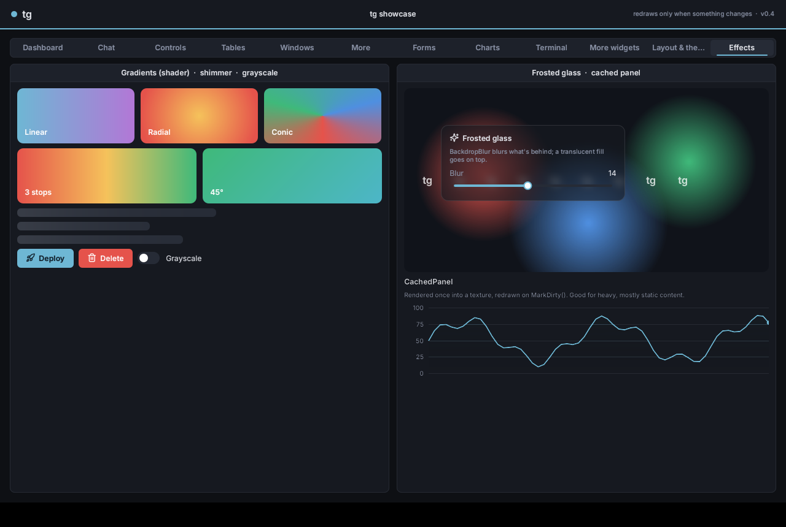

# Rendering: shaders, gradients, blur, render targets, SVG, italics



## Custom shaders

A shader is one function, `effect( color, uv, pos )`, that returns the pixel's color. Write it in GLSL (for the OpenGL 3 renderer), HLSL (Direct3D 11) and/or C++ (the software renderer: tests and screenshots). tg wraps it into a full shader and compiles it on first use.

```cpp
static tg::ShaderDesc Pulse{
    // GLSL
    "vec4 effect( vec4 color, vec2 uv, vec2 pos ) {"
    "  float k = 0.5 + 0.5 * sin( Time * 4.0 );"
    "  return tex( uv ) * mix( color, Params[ 0 ], k ); }",
    // HLSL
    "float4 effect( float4 color, float2 uv, float2 pos ) {"
    "  float k = 0.5 + 0.5 * sin( Time * 4.0 );"
    "  return tex( uv ) * lerp( color, Params[ 0 ], k ); }",
    // C++ (optional)
    []( tg::Color In, tg::Vec2 Uv, tg::Vec2 Pos, const float* P, const auto& Tex ) { return In; } };

void MyWidget::Draw( tg::DrawList& D )
{
    const float Glow[ 4 ] = { 0.43f, 0.72f, 0.83f, 1 };
    D.PushShader( GetContext()->Shader( Pulse ), Glow, 4 );   // compiled once, cached by address
    D.RectFilled( Bounds, tg::Color( 255, 255, 255 ), 8 );
    D.PopShader();
    GetContext()->RequestFrame();                             // animated: keep drawing
}
```

| In your shader | |
|---|---|
| `color` | the vertex color (the color you drew with) |
| `uv`, `tex( uv )` | texture coordinates and the bound texture (the font atlas for shapes and text, your texture for `Image`) |
| `pos` | the pixel position, top-left origin |
| `Params[ 0..7 ]` | `vec4` / `float4`: the floats you passed to `PushShader` (up to 32) |
| `Time`, `Resolution` | seconds, framebuffer size in pixels |

`Ctx.Shader( Desc )` returns 0 when the renderer can't run any of the dialects you gave. Drawing then just uses the normal shader, so always pick sensible fallback colors. Everything drawn between `PushShader` and `PopShader` uses the shader, text included: to keep text readable, multiply by `tex( uv )`, as the default shader does.

**Built-in effects** (`tg::Effects`): `Gradient()`, `Shimmer()` (a moving highlight for loading skeletons), `Grayscale()`. To apply one to a whole subtree:

```cpp
auto& Fx = W.Add<tg::Effect>( tg::Effects::Grayscale(), std::vector<float>{ 1 } );  // children drawn through it
Fx.Params[ 0 ] = 0;                                                               // change parameters any time
```

## Gradients

```cpp
tg::FillGradient( D, Ctx, R, tg::Gradient::Linear( 90, Top, Bottom ), Radius );   // angle in degrees
tg::FillGradient( D, Ctx, R, tg::Gradient::Radial( Center, Edge ) );
tg::FillGradient( D, Ctx, R, tg::Gradient::Conic( A, B, C ) );
tg::Gradient G = tg::Gradient::Linear( 0, Red, Yellow );  G.At[ 1 ] = 0.5f;  G.Stop( 1, Green );  // up to 4 stops
```

With shaders the gradient is exact per pixel. Without them (Direct3D 9, or a shader compiler that refuses it) tg draws a fine mesh colored by the same math, so it still looks right. To recolor any shape you've already drawn: `D.ShadeLinear( VtxStart, From, To, A, B )` and `D.ShadeRadial( VtxStart, Center, Radius, Inner, Outer )`.

## Frosted glass (backdrop blur)

```cpp
auto& Glass = W.Add<tg::Backdrop>();     // blurs what's behind it, then a translucent fill, then its children
Glass.Blur = 14; Glass.Radius = 12; Glass.Fill = tg::Color( 22, 25, 32, 150 );
D.BackdropBlur( R, Amount, Radius );     // low level, inside your own Draw()
```

The renderer copies what's behind the area, blurs it in two passes at half resolution, and draws it back through a rounded-rect mask.

## Render to texture

```cpp
auto& Cache = W.Add<tg::CachedPanel>();  // children rendered once into a texture
Cache.Add<tg::LineChart>( 600 );
Cache.MarkDirty();                       // when the content changes
Cache.RefreshEvery = 1.0;                // or on a timer
```

Input still goes to the real widgets; only their drawing is cached. Lower level: `Renderer::CreateRenderTarget( W, H )`, `Renderer::RenderTo( Target, List, Size, Scale )`, and `Ctx.RenderOffscreen( Target, std::move( List ), SizePx )`, which renders before the next frame.

## SVG

```cpp
W.Svg( LogoSvg, { 120, 40 } );                       // rasterized at the exact pixel size: sharp at any DPI
auto& I = W.Svg( LoadFile( "cpu.svg" ), { 24, 24 } );
I.Tinted = true;  I.Tint = tg::Tok::Accent;          // one-color icons follow the theme
tg::TextureId T = tg::RasterizeSvg( Ctx.GetRenderer(), Text, 256, 256 );
```

SVG support uses [nanosvg](https://github.com/memononen/nanosvg) (zlib license, vendored): paths, basic shapes, fills, strokes and gradients. It has no text elements and no filters.

## Italics and font families

`Theme().Italic`, `BoldItalic` and `MonoItalic` are synthesized from the upright faces (slanted glyphs, same metrics), so RichText `*emphasis*` and the terminal's italic attribute work out of the box. With real italic files:

```cpp
tg::FontFamily F = Ctx.Fonts.AddFamily( "Inter-Regular.ttf", "Inter-Bold.ttf", 15,
                                        "Inter-Italic.ttf", "Inter-BoldItalic.ttf" );   // italics optional
Label.Style.TextFont = F.Get( /*Bold*/ true, /*Italic*/ true );
tg::Font* Slanted = Ctx.Fonts.AddOblique( MyFont, 0.2f );
```

## What each renderer supports

| | GL3 | Direct3D 11 | Direct3D 9 | Vulkan | Software |
|---|---|---|---|---|---|
| Custom shaders | GLSL | HLSL (d3dcompiler_47) | no (fallback) | the same GLSL, compiled at runtime with shaderc (when found) | C++ |
| Backdrop blur | yes | yes (no MSAA back buffers) | no | no (the panel's tint only) | yes |
| Render targets | yes | yes | no (draws normally) | yes | yes |
| Frame capture (eyedropper) | yes | yes | no | headless mode | yes |

There's no Metal renderer. On macOS, use GLFW + OpenGL 3, or Vulkan through MoltenVK.

Your own renderer can opt in to each of these by overriding `CanShade`, `CreateShader`, `CanBackdrop`, `CreateRenderTarget` / `RenderTo` and `CanCapture`. See [Platforms & renderers](backends.md).
