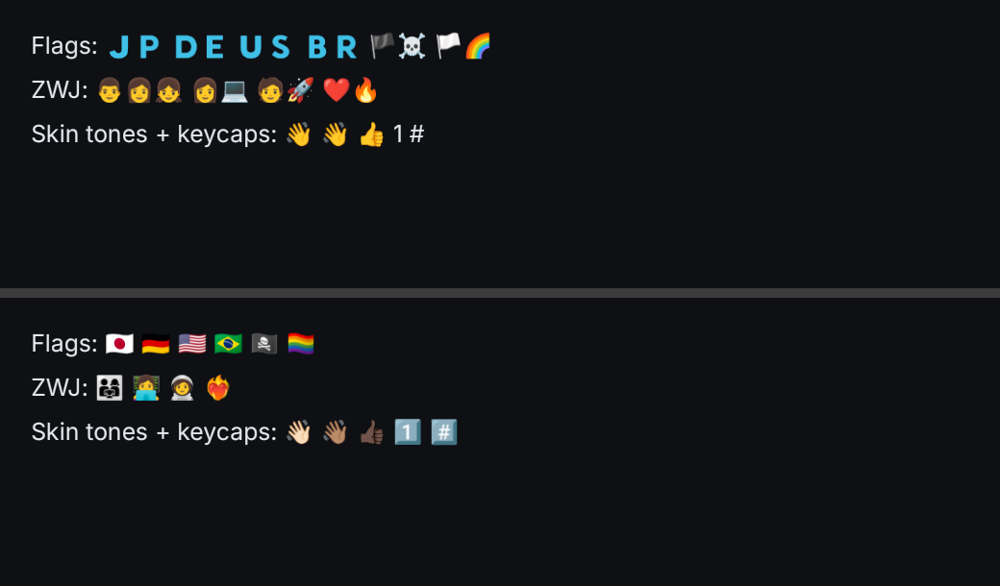
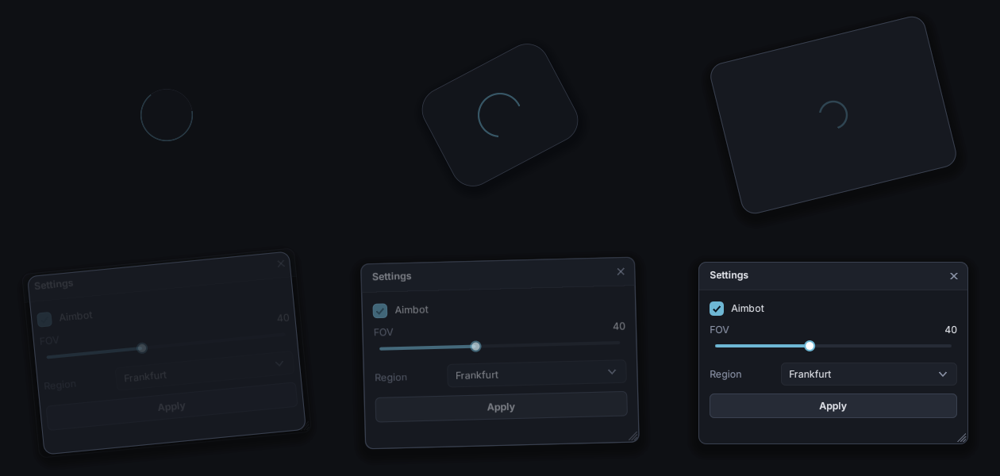

# Styling

tg's styling is designed so you never have to go digging. There are four levels; use the most local one that does the job.

| Level | Changes | How |
|---|---|---|
| 1. Theme palette | every widget | `tg::GetTheme()[ tg::Tok::Accent ] = ...` |
| 2. Type defaults | every *new* widget of a type | `tg::Checkbox::Defaults().Radius = 0;` |
| 3. Instance style | one widget | `MyBox.Style.Fill = tg::Tok::Danger;` |
| 4. The code | the look itself | edit `Draw()` in `src/widgets/<widget>.cpp`, or subclass |

## 1. Theme

`tg::GetTheme()` returns the active `tg::Theme`: 14 color tokens, a base radius and four fonts.

| Token | Used for |
|---|---|
| `Background` | window background |
| `Surface` | panels, cards, windows, groupboxes |
| `SurfaceAlt` | inputs, wells, headers, tab strips |
| `Raised` | buttons, slider and progress tracks |
| `Border`, `BorderStrong` | outlines |
| `Text`, `TextDim` | primary / secondary text |
| `TextOnAccent` | text on accent-filled things (primary buttons) |
| `Accent`, `AccentHover` | checks, toggles, focus rings, selected tabs, charts |
| `Success`, `Warning`, `Danger` | status colors, danger buttons |

```cpp
tg::Theme& T = tg::GetTheme();
T[ tg::Tok::Accent ] = tg::Color::Hex( 0xFF4F81 );
T.UseColors( tg::Theme::Light() );          // swap the whole palette, keep the fonts
Ctx.RequestFrame();                          // theme changes don't trigger a redraw by themselves
```

Fonts: `T.Body`, `T.Medium`, `T.Bold`, `T.Small` and `T.Title` (`tg::Font*`). See [Fonts](#fonts).

## Fonts

tg ships Inter (compiled in) and renders it for UI use:

- **Kerning:** pairs like "AV", "To" and "Ty" are spaced the way the font designer intended. tg reads both the classic `kern` table and GPOS pair kerning, including the "extension" lookups that Inter, Roboto and Noto use.
- **Subpixel positioning:** the atlas is oversampled horizontally (2×), so letters sit on half pixels and spacing stays even instead of every glyph snapping to a whole pixel.
- **Coverage gamma:** stb_truetype's antialiasing is linear, which makes small text look thin, especially light-on-dark. A gamma of 1.3 lifts partial coverage so strokes read solid without looking bold.
- **Weights:** body text is Inter Regular 15; small text (captions, axis labels) is Inter **Medium** 12.5, because unhinted small text thins out; headings and titles use SemiBold.
- **DPI:** glyphs are rasterized at the real scale (150%, 200%...), never stretched.

Tune or turn these off before the fonts load:

```cpp
Ctx.Fonts.Quality.OversampleH = 3;     // 1 = whole-pixel positioning
Ctx.Fonts.Quality.Gamma = 1.0f;        // linear coverage
Ctx.Fonts.Quality.Kerning = false;
Ctx.LoadDefaultFonts( Scale );
```

### FreeType, emoji and other scripts

By default glyphs are rasterized with stb_truetype (vendored, no dependencies). Configure with **`-DTG_FREETYPE=ON`** to use FreeType instead. CMake uses the system FreeType if it finds one, and otherwise downloads and builds it (typical on Windows). The downloaded build has no libpng, which is fine for Segoe UI Emoji (vector COLR). Bitmap emoji fonts (Noto Color Emoji, Apple Color Emoji) need a FreeType built with PNG, which system packages are. You get:

- **Light hinting**: stems snap to the pixel grid vertically, so small text is sharper. Glyph widths stay the same as with stb, so layout doesn't move.
- **Color emoji** 😀🚀🎉. tg finds the system emoji font (Segoe UI Emoji, Apple Color Emoji or Noto Color Emoji) and uses it for any codepoint the text font lacks. Without FreeType, emoji show as the missing-glyph box.

```cpp
Ctx.Fonts.Quality.Engine = tg::FontEngine::FreeType;  // FreeType for everything (emoji use it either way)
Ctx.Fonts.Quality.EmojiScale = 1.1f;                  // emoji a bit larger than the text
Ctx.LoadDefaultFonts( Scale );
```

**Fallback fonts.** Glyphs are rasterized on demand into an atlas that grows as needed, so any codepoint can show up at runtime (chat messages, terminal output). When the font doesn't have a character, tg searches the fallback list in order. `LoadDefaultFonts` adds the emoji font and a system CJK font (Microsoft YaHei, PingFang, Noto Sans CJK or WenQuanYi). The CJK font is only read from disk the first time a Chinese, Japanese or Korean character is drawn. To add your own:

```cpp
Ctx.Fonts.AddFallbackFile( "C:/Windows/Fonts/seguisym.ttf" );  // symbols
Ctx.Fonts.AddFallbackFile( "fonts/NotoSansArabic-Regular.ttf" );
```

### Emoji sequences (HarfBuzz)

Many emoji are several codepoints that the emoji font draws as one picture: flags are two regional-indicator letters (🇯🇵 = J + P), families and professions are emoji joined with U+200D (👨‍👩‍👧, 🧑‍🚀), and skin tones (👋🏽) and keycaps (1️⃣) add modifiers. Configure with **`-DTG_HARFBUZZ=ON`**, which also turns on `TG_FREETYPE`. tg then finds these sequences in text, shapes them with HarfBuzz against the emoji font, and draws the single glyph the font has for each one:



*Top: FreeType only. Bottom: `TG_HARFBUZZ=ON`.*

This works everywhere text is drawn (labels, buttons, text fields, chat, the terminal). Text fields move the caret and Backspace over a whole sequence. CMake uses an installed HarfBuzz (`libharfbuzz-dev`, `brew install harfbuzz`, vcpkg) or downloads and builds it.

- **Windows:** Segoe UI Emoji has no flag glyphs, so flags show as two letters there, as they do in other Windows apps. Families, professions, skin tones and keycaps work.
- **Without HarfBuzz:** a sequence draws as its parts (a flag shows as two letters, a family as its separate people), and skin tones and selectors are dropped, so you get the base emoji.

HarfBuzz is only used for emoji sequences, not for laying out all text. Right-to-left scripts (Arabic, Hebrew) and complex scripts (Devanagari, Thai) are still laid out one character at a time.

**Monospace.** `Theme().Mono` / `MonoBold` are JetBrains Mono 14 (compiled in, including box drawing and Powerline symbols), used by the terminal. Use them for code and logs too: `Label.Style.TextFont = tg::GetTheme().Mono;`.

### Your own fonts

For example, the Windows system font:

```cpp
Ctx.LoadFonts( "C:/Windows/Fonts/segoeui.ttf", "C:/Windows/Fonts/segoeuib.ttf", Scale,
               "C:/Windows/Fonts/seguisb.ttf" );   // optional Medium/semibold for small text
```

That sets the theme slots `Body`, `Medium`, `Small`, `Bold` and `Title`. To add more sizes or faces yourself, call `Ctx.Fonts.AddFromFile( Path, Size )` before the atlas is built and assign the returned `tg::Font*` wherever you like (`Label.Style.TextFont = MyFont;`).

## Colors and `Paint`

`tg::Color` is 8-bit RGBA: `Color( 255, 128, 0 )`, `Color( 0, 0, 0, 120 )`, `Color::Hex( 0x6EB7D4 )`, `Color::Hex( 0x6EB7D4, 128 )`. Helpers: `.WithAlpha(a)`, `.Fade(0..1)`, `Color::Lerp(a, b, t)`.

Style structs use `tg::Paint`, which is **either a theme token or a fixed color**:

```cpp
Cb.Style.Fill = tg::Tok::Danger;            // follows theme changes
Cb.Style.Fill = tg::Color( 255, 64, 64 );   // always this exact red
```

## 2. Type defaults

Most widgets have `static XxxStyle& Defaults()`. Every instance created afterwards copies it:

```cpp
tg::Checkbox::Defaults().Radius = 0;          // square checkboxes everywhere
tg::Button::Defaults().Radius = 3;
tg::Window::Defaults() = tg::Window::Classic(); // all new windows use the tgui chrome
```

Do this before you build the UI. Existing widgets keep their own copy.

## 3. Instance styles

Every widget has a `Style` (a `Window`'s frame is `Chrome`, a `Groupbox`'s frame is `Frame`):

```cpp
auto& Cb = W.Checkbox( "Square & red", &Value );
Cb.Style.Radius = 0;
Cb.Style.Fill = tg::Tok::Danger;
Cb.Style.BoxHoverStroke = tg::Tok::Danger;
```

Ready-made styles:

| | |
|---|---|
| `tg::Button::Primary()`, `Danger()`, `Ghost()` | button variants |
| `tg::Box::Card()`, `Panel()` | card (surface + border + radius) and flat panel |
| `tg::Window::Classic()` | tgui window chrome: centered title, accent line |

```cpp
W.Button( "Deploy" ).Style = tg::Button::Primary();
```

## 4. Edit the code

Each widget's whole look is its `Draw()`. For example, `src/widgets/checkbox.cpp`:

```cpp
void Checkbox::Draw( DrawList& D )
{
    ...
    // 1) empty box + border (border picks up the accent on hover)
    D.RectFilled( Box, S.Box.Resolve(), S.Radius );
    D.RectStroke( Box, Color::Lerp( S.BoxStroke.Resolve(), S.BoxHoverStroke.Resolve(), HoverT * 0.6f ), S.Radius );
    // 2) accent fill fades in when checked
    D.RectFilled( Box, S.Fill.Resolve().Fade( CheckT ), S.Radius );
    // 3) the tick draws itself: first stroke, then the long stroke
    ...
    // 4) label: dim when off, bright when on or hovered
    ...
}
```

You can change it in place, or subclass and override `Draw()` for a one-off look:

```cpp
class PillCheckbox : public tg::Checkbox
{
public:
    using Checkbox::Checkbox;
    void Draw( tg::DrawList& D ) override
    {
        bool On = IsChecked();
        D.RectFilled( Bounds, tg::GetTheme()[ On ? tg::Tok::Accent : tg::Tok::Raised ], Bounds.h * 0.5f );
        // ... text, etc.
    }
};
W.Add<PillCheckbox>( "Pill", &Value );
```

## Animation in styles

Hover, press, check and open states ease in rather than snapping. Widgets keep small `0..1` animation values (`HoverT`, `CheckT`, ...) and blend between style colors with them. Speed is the third argument to `Animate( Value, Target, Speed )` in each widget's `Draw()`.

The bigger motions, and how to tune or turn them off:

| What | How it moves | Knob |
|---|---|---|
| Window open / close | **Spin**: a circle with a spinning accent arc unfolds into the window while it turns and pops in; closing plays it backwards, faster. Also **Zoom** (scale + fade), **Fade**, **None** | `Win.Chrome.OpenAnim = tg::WindowStyle::Anim::Zoom;` `OpenTime`, `CloseTime`. `Win.IsOpen()` is false as soon as closing starts |
| Dropdowns, color pickers, date pickers, menus | unroll from the field (downward, or upward when they open above), slide 8px and fade in; fade out when closed | `Popup.Animated`, `OpenTime`, `CloseTime` |
| Buttons | a ripple spreads from the click point, clipped to the button's rounded shape | `ButtonStyle::Ripple` |
| Checkboxes | the tick spins a quarter turn and pops in while it draws itself | `CheckboxStyle::SpinIn` |
| Sliders | the knob glides to the new value (clicks, key binds, code); quick while dragging | the speed in `Slider::Draw()` |
| Tabs | the highlight slides between tabs and moves with the tab strip, so it stays put when you drag a window | |



Easing helpers for your own widgets live in `core.h`: `EaseOutCubic`, `EaseInCubic`, `EaseInOutCubic`, `EaseOutBack`. To animate a whole subtree, draw it, then `D.TransformFrom( VtxStart, CmdStart, Center, Scale, Angle, Offset )` and `D.FadeFrom( VtxStart, Alpha )`. That's how windows and popups do it.

## Light and dark

```cpp
tg::GetTheme().UseColors( tg::Theme::Light() );
tg::GetTheme().UseColors( tg::Theme::Dark() );   // the default
```

Every built-in style uses tokens, so the whole UI follows. Literal colors you set yourself won't change.
