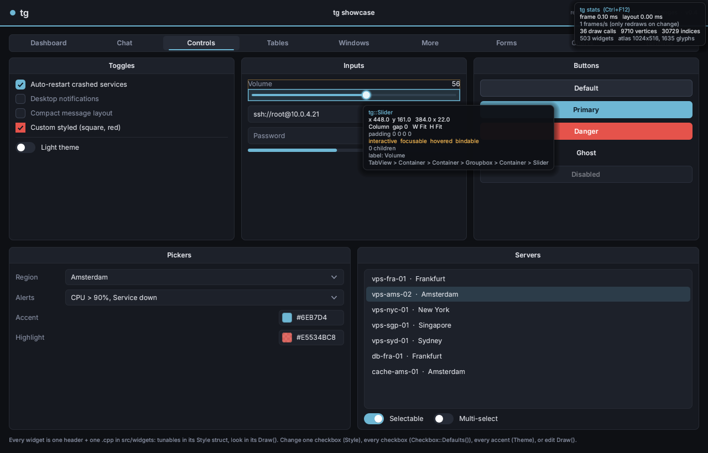

# App systems

Things every app needs, built in: keyboard navigation, shortcuts, undo, saved settings, and developer tools.

## Keyboard navigation

| Key | |
|---|---|
| **Tab** / **Shift+Tab** | move focus through buttons, checkboxes, toggles, sliders, combos, pickers, segmented controls and text fields, in tree order (only inside the open dialog, if there is one) |
| **Enter** / **Space** | click the focused control (button, checkbox, toggle, combo, color / date picker, keybind) |
| **Arrows** | slider ±1 step (Shift ×10, Home/End, PgUp/PgDn); combo: next / previous option while closed; segmented & radio: next / previous |
| **Up / Down, Home / End, Enter** in an open menu or dropdown | highlight and pick items |
| **Escape** | close the newest popup / dialog |

A focus ring is drawn while you use the keyboard and hidden as soon as you click. `Ctx.TabNavigation = false` turns Tab handling off. `Ctx.FocusNext( Backward )` and `Ctx.Click( W )` do the same from code. Your own widgets join in by setting `Focusable = true` (a Tab stop) and `KeyActivates = true` (Enter / Space click it), and by handling `KeyDown` in `OnEvent`.

## Shortcuts

```cpp
Ctx.Shortcut( "Ctrl+S", [&] { Save(); } );
Ctx.Shortcut( "Ctrl+Shift+P", [&] { OpenPalette(); } );
uint32_t Id = Ctx.Shortcut( "F5", [&] { Refresh(); } );
Ctx.RemoveShortcut( Id );
```

Combos with Ctrl, Alt or Super work everywhere, including while typing. Plain keys (`F5`, `Delete`) don't fire while a text field or the terminal has focus. The focused widget gets the key first, so Ctrl+C in a text field still copies. `Context::ParseShortcut` and `Context::ShortcutText` convert between strings and key + modifiers. Use them to show shortcuts in menus: `M.Item( "Save", Fn, "Ctrl+S" )`.

## Undo / redo

`Ctx.History` records control edits on its own: a checkbox click, a slider drag, a combo pick, arrow keys on a focused slider, a color picked in a popup. **Ctrl+Z** undoes. **Ctrl+Y** or **Ctrl+Shift+Z** redoes. Repeated edits of the same control in quick succession (holding an arrow key) merge into one step. Your own actions:

```cpp
Ctx.History.Push( "Delete vps-fra-01", [=] { Restore( S ); }, [=] { Delete( S ); } );
```

| API | |
|---|---|
| `Undo()`, `Redo()`, `CanUndo()`, `CanRedo()`, `UndoName()`, `RedoName()`, `Clear()` | |
| `Enabled`, `Limit` (200), `OnChange` | update an Edit menu from `OnChange` |

## Saved settings and profiles

Every control that supports key binds also knows how to save its value, under its label.

```cpp
#include "tg/settings.h"

tg::Profiles P( Ctx, "profiles" );     // a folder; created if missing
P.Save( "Ranked" );                    // every control's value + the key binds
P.Load( "Ranked" );
P.List();                              // { "Default", "Ranked", ... }
P.Remove( "Ranked" );
std::string Share = P.Export();        // as text: paste it to a friend
P.Import( Share );

std::string S = tg::SaveValues( Ctx.Root() );   // just the values, one "label <tab> values" line each
tg::LoadValues( S, Ctx.Root() );
```

When two controls share a label, the second is saved as `Label#2`, the third as `Label#3`, and so on, so give important controls distinct labels.

## Developer tools

| Key | |
|---|---|
| **F12** | inspector: hover anything to see its type, bounds, layout (direction, gap, sizes, padding), flags, label and its path from the root. The parent's bounds are outlined in orange and the padding in green |
| **Ctrl+F12** | stats: frame and layout time, draw calls, vertices, widget count, glyph atlas size |

`Ctx.ShowInspector`, `Ctx.ShowStats`, and `Ctx.DevToolKeys = false` (to ship without the keys).


