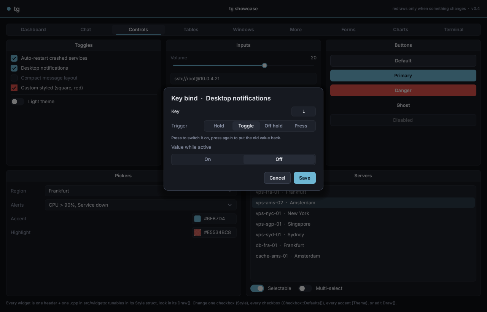
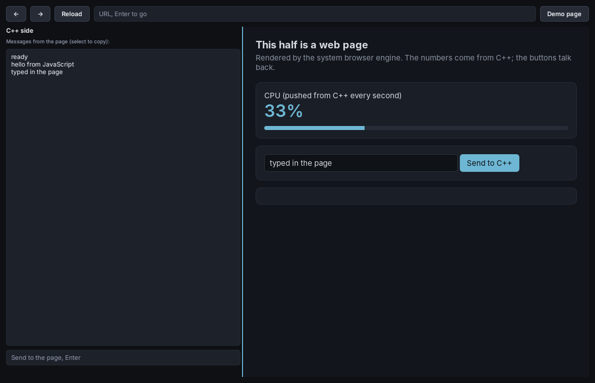
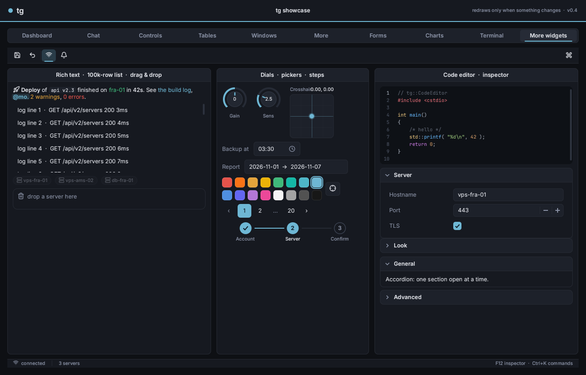
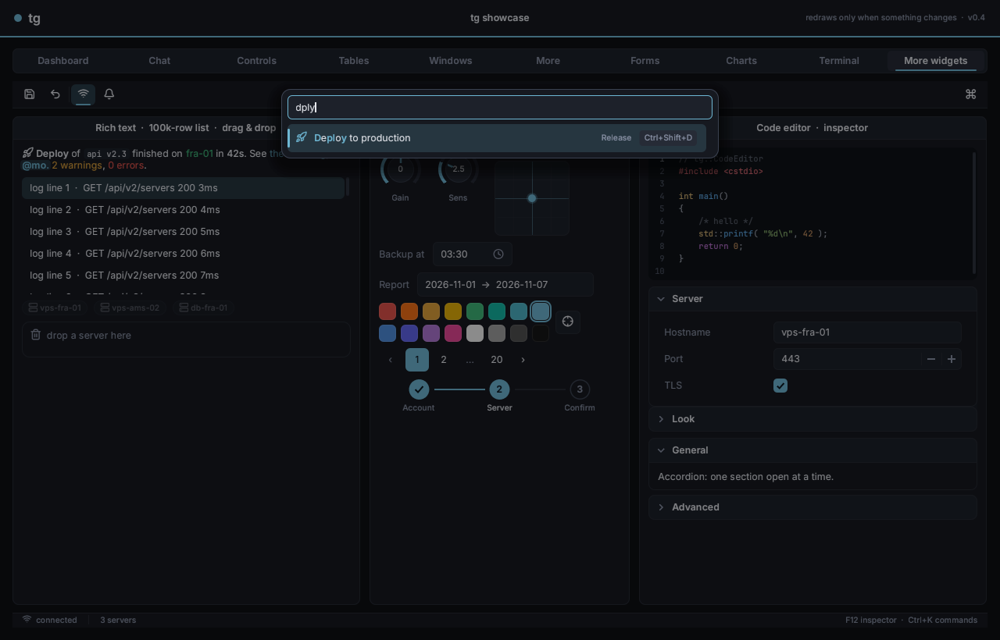

# Controls reference

Each section shows the one-line `Container` helper (works on windows, groupboxes, tab pages, cards and `App.Main()`), the full constructor, and the API. Every widget also has a `Style` struct you can edit (see [Styling](styling.md)), and the usual `Widget` members (`Layout`, `Visible`, `Enabled`, `Bounds`...).

Value-editing widgets take an optional pointer to **your** variable. When it's `nullptr`, the widget stores the value itself.

---

## Text

### Label

```cpp
W.Text( "Hello" );                      // plain
W.Text( LongParagraph, /*Wrap*/ true ); // word-wrapped to the available width
W.Heading( "Section" );                 // bold
W.Caption( "small dim hint, wraps" );
Parent.Add<tg::Label>( "Hello", /*Wrap*/ false );
```

| API | |
|---|---|
| `SetText( std::string )`, `GetText()` | updating with same-width text only redraws; otherwise it relayouts |
| `Wrap` | word-wrap to the arranged width |
| `SetSelectable( true )` | let people select and copy it: drag, double-click a word, triple-click all, Ctrl+C, right-click Copy / Select All. Use it for chat messages, logs, IDs and IPs |
| `SelectedText()`, `SelectAll()`, `IsSelectable()` | |
| `Style.TextColor`, `Style.TextFont` (`nullptr` = `Theme().Body`), `Style.HAlign`, `Style.VAlign`, `Style.SelectionFill` | |

```cpp
W.Text( Msg.Body, true ).SetSelectable( true ); // a chat message people can copy from
```

---

## Buttons and toggles

### Button

```cpp
W.Button( "Save", [] { Save(); } ).Style = tg::Button::Primary();
Parent.Add<tg::Button>( "Save", OnClick );
```

| API | |
|---|---|
| `Text`, `OnClick` | `OnClick` runs on release over the button |
| `Button::Primary()`, `Danger()`, `Ghost()`, `Defaults()` | style presets |
| `Style.Fill`, `Stroke`, `TextColor`, `HoverOverlay`, `PressOverlay`, `Radius`, `Padding` | |
| `Enabled = false` | dimmed, not clickable |

### Checkbox

```cpp
W.Checkbox( "Enabled", &Enabled );
Parent.Add<tg::Checkbox>( "Enabled", &Enabled );
```

| API | |
|---|---|
| `IsChecked()`, `SetChecked( bool )`, `OnChange( bool )`, `Bind` | |
| `Style`: `BoxSize`, `Radius`, `LabelGap`, `CheckThickness`, `Box`, `BoxStroke`, `BoxHoverStroke`, `Fill`, `Check`, `TextColor`, `TextColorOff` | label is dim when off, like tgui |

### Toggle

An on/off switch with the same API as Checkbox: `IsOn()`, `SetOn()`, `OnChange`, `Bind`.

```cpp
W.Toggle( "Dark mode", &Dark );
```

`Style`: `TrackWidth`, `TrackHeight`, `KnobInset`, `LabelGap`, `TrackOff`, `TrackOn`, `Knob`, `TextColor`.

---

## Values

### Slider

```cpp
W.Slider( "Volume", &Volume, 0, 1 );           // label + value above, bar below (tgui layout)
W.Slider( "Opacity", &Op, 0, 1, 0, "%.0f%%" );  // custom value format
W.SliderInt( "FPS cap", &Fps, 30, 240 );        // binds an int
Parent.Add<tg::Slider>( &Value, Min, Max, /*Step*/ 0 );  // bare bar, no label
```

| API | |
|---|---|
| `GetValue()`, `SetValue( float )`, `OnChange( float )`, `Bind`, `Min`, `Max`, `Step` | `Step > 0` snaps (1 = integers) |
| `Style`: `TrackHeight`, `KnobRadius`, `Height`, `Track`, `TrackFill`, `Knob`, `KnobStroke` | |

### ProgressBar

```cpp
auto& P = W.Progress( 0.4f );
P.SetValue( 0.75f );                  // animates to the new value
P.Style.Thresholds = true;           // Fill -> WarnFill at WarnAt -> HotFill at HotAt (usage meters)
```

`Style`: `Height`, `Radius`, `Track`, `Fill`, `Thresholds`, `WarnAt`, `HotAt`, `WarnFill`, `HotFill`.

---

## Text entry

### TextInput

```cpp
W.Input( "Nickname", &Name );              // two-way: edits write to Name
auto& Chat = Parent.Add<tg::TextInput>( "Message #general" );
Chat.OnSubmit = []( const std::string& T ) { Send( T ); };
Chat.ClearOnSubmit = true;
auto& Pw = W.Input( "Password" );
Pw.Password = true;
```

| API | |
|---|---|
| `GetText()`, `SetText()`, `Placeholder`, `OnChange`, `OnSubmit`, `ClearOnSubmit`, `Password` | |
| Keys | arrows, Home/End, Backspace/Delete, Shift-select, Ctrl+A/C/X/V, Enter submits, Escape unfocuses |
| Mouse | click + drag selects, double-click selects a word, triple-click selects everything; right-click: Cut / Copy / Paste / Select All (TextArea too; replace `ContextMenu` to change it) |
| `Style`: `Fill`, `Stroke`, `StrokeFocused`, `TextColor`, `Placeholder`, `Selection`, `Radius`, `Padding` | |

### TextArea

```cpp
W.TextArea( "Notes", &Notes );                        // multi-line, word-wrapped, two-way bound

auto& Box = W.TextArea( "Message" );                  // chat composer
Box.SubmitOnEnter = true;                             // Enter sends, Shift+Enter = newline
Box.ClearOnSubmit = true;
Box.MinLines = 1;  Box.MaxLines = 6;                  // grows with the text, then scrolls
Box.OnSubmit = []( const std::string& T ) { Send( T ); };
```

- **Navigation:** arrows (Up/Down keep the column), Home/End (Ctrl = start/end of the text).
- **Editing:** Backspace/Delete, Shift to select, Ctrl+A/C/X/V (pasting keeps newlines). Ctrl+Enter submits; Escape unfocuses.
- **Mouse:** click and drag to select; the wheel scrolls.

`GetText()`, `SetText()`, `Bind`, `OnChange`, `OnSubmit`, `ReadOnly`, `LineCount()`. `Style`: `Fill`, `Stroke`, `StrokeFocused`, `TextColor`, `Placeholder`, `Selection`, `Thumb`, `Radius`, `Padding`.

### SearchBox

```cpp
W.Search( "Filter servers", &Query ).OnChange = []( const std::string& Q ) { Refilter( Q ); };
```

A pill-shaped field with a magnifier and an × that clears it; Escape also clears. `GetText()`, `SetText()`, `OnChange`, `OnSubmit`, `Field()`.

### TagInput

```cpp
static std::vector<std::string> Tags = { "prod", "eu-west" };
W.Tags( &Tags, "Add tag" );
```

- **Adding:** type and press Enter, or type a comma. Duplicates are ignored unless `AllowDuplicates`.
- **Removing:** Backspace in the empty field removes the last chip; × removes any chip.
- **Layout:** chips wrap onto new lines.

`GetTags()`, `AddTag()`, `RemoveTag()`, `OnChange`.

### DatePicker

```cpp
static tg::Date Expires = tg::Date::Today();
W.Date( "Expires", &Expires );
```

The popup is a month calendar (Monday first): ‹ › or the wheel change the month, today is outlined, and a "Today" shortcut sits underneath. `tg::Date` has `Year`, `Month`, `Day`, `Today()`, `DaysInMonth()`, `Weekday()` and `ToString()` ("2026-11-07"). `Calendar` is the grid alone, for embedding.

### Key binds on any control

Right-click a checkbox, toggle, slider, number field, combo, multicombo, radio group, segmented control, color picker or button, and choose **Add key bind...**. The person using your app picks:

- **a key**: any keyboard key or mouse button, side buttons included.
- **a trigger:**

| Trigger | What happens |
|---|---|
| Hold | while the key is held the control has the bound value; letting go puts the old value back |
| Toggle | press: the bound value; press again: back to what it was |
| Off hold | the bound value all the time, *except* while the key is held |
| Press | each press sets the value; nothing is put back |

- **the value** the control takes, edited with a control of the same kind:

| Control | Bound value |
|---|---|
| Checkbox, Toggle | on or off |
| Slider, NumberInput | a number ("when the key is down, volume = 20") |
| Combo, RadioGroup, Segmented | one option |
| MultiCombo | each item on, off, or left alone. Only the items the bind touches are put back |
| ColorPicker | a color |
| Button | the key clicks it |



Binds change controls the same way a click does: your bound variables (`bool*`, `float*`...) update and `OnChange` runs. The right-click menu lists a control's binds (click one to edit it) and can remove them. A control can have several binds. Binds don't fire while someone is typing in a text field or the terminal.

You don't have to write any code for this, but you can drive it, save it and restore it:

```cpp
Ctx.Binds.Add( AimCheckbox, tg::Key::Mouse5, tg::BindTrigger::Hold, { { 1 } } );
Ctx.Binds.Add( FovSlider, tg::Key::Z, tg::BindTrigger::Toggle, { { 30 } } );

Ctx.Binds.OnEdit = [&] { WriteFile( "binds.txt", Ctx.Binds.Save() ); }; // after any change made in the UI
Ctx.Binds.Load( ReadFile( "binds.txt" ), Ctx.Root() );                  // at startup; matched by label
```

| API | |
|---|---|
| `Ctx.Binds.Add( W, Key, Trigger, Value )`, `Update`, `Remove( Id )`, `RemoveAll( W )`, `Clear()`, `For( W )`, `All()` | |
| `Save()` / `Load( Text, Root )` | one line per bind: label, key, trigger, values. `Load` replaces the current binds and finds controls by their label |
| `OnEdit` | called after the user adds, edits or removes a bind |
| `Enabled` | `false` turns the feature off (no menu items, keys do nothing) |
| `W.Bindable = false` | no bind menu on one control |
| `Describe( B )`, `OpenEditor( W )` | "F · hold → 20"; open the editor yourself |

**Your own widgets** opt in by overriding `CanBind()`, `BindGet()`, `BindSet()` and optionally `BindEditor()`, `BindText()`, `BindName()` and `BindDefault()`. `src/widgets/checkbox.cpp` is about a dozen lines. A `BindValue` is a list of doubles; NaN means "leave this part alone".

### Keybind

```cpp
static tg::Key AimKey = tg::Key::Mouse5;
auto& K = W.Keybind( "Aim key", &AimKey );
K.ShowMode = true;                        // "MOUSE5 · hold"
if ( K.IsActive() ) { ... }               // respects the mode
```

Click it and the box shows "..." while it listens. The next key **or mouse button** (including side buttons) becomes the bind, and **Escape unbinds** (like tgui). Right-click to pick **hold / toggle / always**.

| API | |
|---|---|
| `GetKey()`, `SetKey()`, `Bind` (`tg::Key*`), `OnChange( Key )` | |
| `GetMode()`, `SetMode()`, `ModeBind` (`BindMode*`), `AllowModes`, `ShowMode` | |
| `IsActive()` | hold: key held; toggle: flips each press; always: true |
| `IsListening()`, `StartListening()`, `StopListening()` | |
| `tg::KeyName( Key )` | `"F5"`, `"LSHIFT"`, `"MOUSE4"`... |

---

## Choosing

### Combo (pick one)

```cpp
W.Combo( "Region", { "Frankfurt", "Amsterdam", "Tokyo" }, &RegionIndex );
W.Combo( "", Items, &Index );               // no label: full width
Parent.Add<tg::Combo>( Items, &Index );
```

| API | |
|---|---|
| `GetIndex()`, `SetIndex()`, `GetSelectedText()`, `OnChange( int )`, `Bind` | `-1` = nothing selected |
| `SetItems()`, `GetItems()`, `Placeholder`, `OpenList()`, `CloseList()`, `IsOpen()` | |
| `Style`: `Fill`, `Stroke`, `StrokeOpen`, `TextColor`, `Placeholder`, `Chevron`, `Radius`, `Padding`, `MaxPopupHeight` | long lists scroll |

### MultiCombo (pick several)

```cpp
static std::vector<bool> Alerts( 5 );
W.MultiCombo( "Alerts", { "CPU", "Disk", "Down", "SSH", "Backup" }, &Alerts );
```

The dropdown stays open while you tick items. The field shows "a, b" when it fits, otherwise "3 selected".

| API | |
|---|---|
| `IsSelected( i )`, `SetSelected( i, bool )`, `SelectedIndices()`, `OnChange( const vector<bool>& )`, `Bind` | |

### MenuBar

```cpp
auto& Bar = W.MenuBar();                    // or App.Main().MenuBar() for a window-wide bar
Bar.Add( "File", [&]( tg::Menu& M ) {        // builder runs each time the menu opens
    M.Item( "New", [] { ... }, "Ctrl+N" );
    M.Separator();
    M.Item( "Quit", [&] { App.Quit(); } );
} );
Bar.Add( "View", [&]( tg::Menu& M ) { M.Check( "Word wrap", &Wrap ); } );
```

Click a title to open its menu. While one is open, hovering another title switches to it, as in desktop apps. `OpenIndex()`, `CloseMenu()`, `OpenIndexNow()`.

### ListBox

```cpp
auto& L = W.List( { "alpha", "beta", "gamma" }, tg::SelectMode::Single, &Selected );
L.Layout.Height = tg::Grow();          // default height is 180
L.SetMode( tg::SelectMode::None );     // plain, read-only list
L.SetMode( tg::SelectMode::Multi );    // checkboxes
L.Reorderable = true;                  // drag rows to reorder (insertion line + floating row)
L.OnReorder = []( int From, int To ) { ... };
```

| API | |
|---|---|
| `SetItems()`, `AddItem()`, `RemoveItem()`, `Count()`, `GetItem()` | |
| `GetMode()`, `SetMode()` | `None` / `Single` / `Multi`, switchable live |
| `GetSelected()`, `IsSelected()`, `SetSelected()`, `ClearSelection()`, `SelectedIndices()`, `Bind` (Single), `OnChange`, `OnActivate( int )` | |

### ColorPicker / ColorPanel

```cpp
W.ColorPicker( "Tint", &Tint );            // swatch + hex; click for the popup
W.ColorPicker( "Text", &TextCol, false );  // no alpha
W.ColorPanel( &Tint );                     // the picker itself, inline
```

The popup has a saturation/value square, a hue bar, an alpha bar over a checkerboard, a preview swatch and a hex field. The hex field accepts `RGB`, `RRGGBB` and `RRGGBBAA`.

| API | |
|---|---|
| `GetColor()`, `SetColor()`, `OnChange( Color )`, `Bind`, `ShowAlpha`, `ShowHex` | |
| Helpers | `tg::ToHSV`, `tg::FromHSV`, `tg::ToHex`, `tg::ParseHex`, `tg::DrawChecker` |

### RadioGroup

```cpp
W.Radio( { "Low", "Medium", "High" }, &Quality );                  // column
W.Radio( { "Day", "Week", "Month" }, &Period, tg::Dir::Row );      // row
```

`GetIndex()`, `SetIndex()`, `OnChange( int )`, `Bind`, `Options`, `Direction`. `Style`: `Size`, `LabelGap`, `ItemGap`, `Ring`, `RingHover`, `Fill`, `Dot`, `TextColor`, `TextColorOff`.

### Segmented

A pill selector with a sliding highlight, for a few short options:

```cpp
W.Segmented( { "1h", "24h", "7d", "30d" }, &Range );
```

`GetIndex()`, `SetIndex()`, `OnChange( int )`, `Bind`, `SegmentRect( i )`. `Style`: `Height`, `Radius`, `Inset`, `MinSegment`, colors.

### NumberInput

```cpp
W.Number( "Scale", &Scale, 0.25f, 4, 0.25f, "%.2f" );   // float, label + field
W.NumberInt( "Port", &Port, 1, 65535 );                  // int
```

- **Input:** type a value and press Enter (or click away), click **−** / **+**, or use **Up/Down** while it's focused (**Shift** = ×10). The wheel also steps while it's focused.
- **Validation:** input that isn't a number is reverted, and values are clamped to `[Min, Max]` and snapped to `Step`.

`GetValue()`, `SetValue()`, `StepBy( n )`, `OnChange( float )`, `Bind`, `Min`, `Max`, `Step`, `Format`, `Field()` (the inner `TextInput`). `Style`: `ButtonWidth`, `Radius`, colors.

### RangeSlider

```cpp
W.Range( "Price", &Lo, &Hi, 0, 1000, 10, "$%.0f" );     // label + "lo – hi" above, two knobs below
```

The nearer knob follows the mouse, and `Low <= High` always holds. `GetLow()`, `GetHigh()`, `SetRange()`, `OnChange( lo, hi )`. Uses `SliderStyle`.

---

## Feedback

### Tooltip (any widget)

```cpp
W.Button( "Deploy" ).Tooltip = "Builds and ships to every region";
```

Every widget has a `Tooltip` string. It works on labels and containers too, and the nearest ancestor with one answers. It shows after `Ctx.TooltipDelay` (0.45 s), wraps at 280 units, stays on screen, and hides when you click. `Ctx.ShownTooltip()` returns the widget whose tooltip is showing.

### Context menu (any widget) and Menu

```cpp
Row.ContextMenu = [&]( tg::Menu& M ) {              // right-click on Row or anything inside it
    M.Header( "vps-fra-01" );
    M.Item( "Connect", [&] { Connect(); }, "Enter" );   // text, action, shortcut hint
    M.Check( "Pinned", &Pinned );                       // tick + flips the bool
    M.Separator();
    M.Item( "Delete", [&] { Delete(); } ).Danger = true;
};

tg::OpenMenu( Btn, Btn.Bounds ).Item( "Export", [] { ... } );   // a "..." button menu
```

The nearest ancestor with a `ContextMenu` answers a right-click, unless the clicked widget handles right-clicks itself (like Keybind). Clicking an item closes the menu, then runs its action. `MenuItem` has `Text`, `Shortcut`, `OnClick`, `Checked` (`bool*`) and `Danger`.

### Dialog (modal)

```cpp
tg::Confirm( Ctx, "Delete vps-fra-01?", "This can't be undone.", { "Cancel", "Delete" },
             [&]( int Choice ) { if ( Choice == 1 ) Delete(); } );    // -1 = dismissed

auto& D = tg::OpenDialog( Ctx, "Rename server" );                     // custom body
auto& Name = D.Body().Input( "New name" );
D.AddButton( "Cancel" );
D.AddButton( "Rename", [&] { Rename( Name.GetText() ); } ).Style = tg::Button::Primary();
```

- **Modal:** it dims and blocks everything behind it.
- **Keys:** Enter presses the last (primary) button, and Escape dismisses with `-1`.
- **Closing:** any button closes it. `OnResult( index )` reports which button.
- **Contents:** `Body()` is a Container, so all the helpers work inside it, including combos and pickers (their popups appear above the dialog).
- **Look:** `Style`: `Width`, `Radius`, `Backdrop`, `Fill`, `Stroke`.

### Toast

```cpp
tg::Toast( Ctx, "Settings saved", tg::Tok::Success );
tg::Toast( Ctx, "Deploy failed: exit code 1", tg::Tok::Danger, 6 );   // seconds; <= 0 = until clicked
```

Toasts stack in the bottom-right corner, slide in, fade out on their own, and close on click. They're safe to call from `Post()`, so background threads can raise them. `tg::ToastCount( Ctx )` returns how many are on screen.

### Spinner, Badge, Link

```cpp
W.Spinner();                                  // animated while visible
W.Badge( "LIVE", tg::Tok::Danger );           // soft pill; .Soft = false for solid
W.Link( "Open the docs", [] { ... } );        // underlined on hover
```

---

## Data

### Table

```cpp
auto& T = W.Table( { "PID", "Name", "CPU", "Status" } );
T.Column( 0 ).Width = tg::Px( 80 );
T.Column( 2 ).TextAlign = tg::Align::End;
size_t Row = T.AddRow( { "1234", "nginx", "3.2%", "running" } );
T.SortBy( 2, /*Ascending*/ false );
T.SetCell( Row, 2, "4.0%" );               // re-sorts if needed
```

What it does:
- **Sorting:** click a header to sort, click again to reverse. Values like "37%" or "1.2 GB" sort as numbers. `TableColumn::Less` overrides the order for a column.
- **Columns:** drag the edge between two headers to resize.
- **Selection:** `Mode = SelectMode::None / Single / Multi`. Row numbers are stable, so sorting changes only the display order; `Bind`, `SetCell` and selection use your original row numbers.
- **Copying:** **Ctrl+C** copies the selected rows as tab-separated text, which pastes into Excel or Sheets as cells. Right-click gives Copy / Copy with headers. `T.SelectedText( WithHeader )` returns the same text.
- **Speed:** only the visible rows are drawn. With 100k rows a scroll frame takes about 0.04 ms.
- **Custom cells:** `CellColor` recolors a cell's text and `DrawCell` paints a cell yourself:

```cpp
T.CellColor = [&]( size_t R, size_t C, tg::Color& Out ) {
    if ( C != 3 ) return false;
    Out = tg::GetTheme()[ T.GetCell( R, C ) == "running" ? tg::Tok::Success : tg::Tok::Danger ];
    return true;
};
T.DrawCell = [&]( tg::DrawList& D, tg::Rect Cell, size_t R, size_t C ) {
    if ( C != 2 ) return false;              // false = default text
    float V = std::atof( T.GetCell( R, C ).c_str() ) / 100;
    D.RectFilled( { Cell.x + 12, Cell.y + 12, ( Cell.w - 24 ) * V, 6 }, tg::GetTheme()[ tg::Tok::Accent ], 3 );
    return true;
};
```

| API | |
|---|---|
| `AddColumn()`, `SetColumns()`, `Column( i )`, `ColumnCount()` | |
| `AddRow()`, `SetRows()`, `SetCell()`, `GetCell()`, `RemoveRow()`, `ClearRows()`, `RowCount()` | |
| `SortBy( Col, Asc )`, `SortColumn()`, `SortAscending()`, `DisplayRow( Position )` | |
| `GetSelected()`, `IsSelected()`, `SetSelected()`, `ClearSelection()`, `SelectedRows()`, `OnSelect`, `OnActivate( Row )` | |
| `ScrollToRow()`, `GetScroll()` | |
| `Style`: `RowHeight`, `HeaderHeight`, `CellPadding`, `Striped`, `GridLines`, colors | |

### TreeView

```cpp
auto& T = W.Tree();
auto& Eu = T.Add( "Europe" );
Eu.Add( "vps-fra-01", /*Id*/ 17 );
Eu.Add( "db-fra-01" ).Color = tg::Tok::Warning;
Eu.Expanded = true;
T.OnSelect = []( tg::TreeNode& N ) { Open( N.Id ); };
T.ContextMenu = [&]( tg::Menu& M ) { M.Item( "Restart " + T.GetSelected()->Text, ... ); };
```

- **Mouse:** click the chevron to expand or collapse, click a row to select it. The wheel scrolls.
- **Keyboard (when focused):** **Up/Down** move the selection; **Left** collapses or goes to the parent, **Right** expands.
- **Drawing:** rows are painted directly, with indentation guides.

`TreeNode`: `Text`, `Expanded`, `Id`, `Color`, `Children`, `Parent`, `Add()`, `Remove()`, `Depth()`. `TreeView`: `Root`, `Add()`, `Clear()`, `ExpandAll()`, `Select()`, `GetSelected()`, `Toggle()`, `OnSelect`, `OnActivate`, `OnToggle`.

### BarChart, DonutChart, Gauge, Sparkline

```cpp
auto& B = W.BarChart();
B.Format = "%.0fk";
B.SetBars( { { "Mon", 42 }, { "Tue", 58 }, { "Sat", 23, tg::Tok::TextDim } } );   // label, value, color
B.SetValue( 0, 45 );                                                              // bars animate to new values

auto& P = W.Donut();
P.SetSlices( { { "api", 46, tg::Tok::Accent }, { "chat", 27, tg::Tok::Success } } );
P.Center = "100%";  P.CenterSub = "of traffic";                                   // "" = total / hovered slice

auto& G = W.Gauge( "CPU", 0.42f );          // 0..1; turns WarnFill / HotFill past WarnAt / HotAt
G.SetValue( Cpu / 100 );

auto& S = W.Sparkline( 40 );                // tiny inline trend, newest on the right
S.Push( Latency );
```

- **BarChart:** the axis is rounded to nice steps; hovering a bar highlights it and shows a tooltip with its value.
- **DonutChart:** the hovered slice pops out and the center shows its value.
- **Gauge:** a 270° arc with the value in the middle.

### LineChart

```cpp
auto& C = Card.Add<tg::LineChart>( /*Capacity*/ 90 );
C.Unit = "%";
C.Push( 37.f );              // newest at the right, history scrolls left
C.AutoRange = true;          // otherwise Min / Max (default 0..100)
```

`Style`: `Line`, `Grid`, `AxisText`, `LineWidth`, `FillAlpha` (gradient under the line, 0 = none), `GridLines`, `Height`.

### Image

```cpp
auto& Img = Parent.Add<tg::Image>( Tex, W, H );
Img.Style.Mode = tg::ImageFit::Cover;   // Contain (letterbox), Cover (crop), Stretch
Img.Style.Radius = 8;
Img.SetSource( Tex, NewW, NewH );
```

See [live textures](concepts.md#live-textures-screen-share-video-camera).

### Terminal

A VT/xterm terminal emulator. Run a process in it, or feed it bytes yourself.

```cpp
auto& T = W.Terminal();
T.Spawn();                                  // your shell in a pseudo-terminal ($SHELL, or cmd.exe on Windows)
T.Spawn( "htop" );                          // or any command line
T.OnTitle = []( const std::string& S ) { /* window title the program set */ };
T.OnExit  = []( int Code ) { /* process ended */ };
```

Without a process (an SSH library, a websocket to your VPS agent, build logs):

```cpp
T.Write( "\x1b[32m✓\x1b[0m deployed\r\n" );          // anything a terminal understands
T.OnInput = [&]( std::string_view Bytes ) { Sock.Send( Bytes ); }; // keys, paste, replies to queries
T.OnResize = [&]( int Cols, int Rows ) { Ssh.ResizePty( Cols, Rows ); };
```

`Write` must run on the UI thread. From a network thread, wrap it in `Ctx.Post( [=] { T.Write( Data ); } )`. `Spawn` does that for you.

What it understands: 16 / 256 / 24-bit color; bold, dim, italic (no italic face, so drawn upright), underline, inverse and strikethrough; cursor movement and erase; scroll regions; insert/delete of lines and characters; the alternate screen (vim, htop, less, tmux); autowrap; tabs; DEC line drawing; wide characters (CJK, emoji), with emoji sequences (flags, ZWJ, skin tones) kept in one cell and drawn as one glyph in `TG_HARFBUZZ` builds; bracketed paste; cursor-position and device-attribute reports; and the window title (OSC 0/2). Box drawing, block elements and braille are drawn as shapes, so lines join seamlessly and graphs from `btop` look right with any font.

**Mouse reporting.** When a program asks for the mouse (vim with `set mouse=a`, htop, tmux, mc, less with `--mouse`), clicks, drags, the wheel and right-clicks go to it. tg supports the xterm modes 9, 1000, 1002 and 1003 with the SGR (1006), urxvt (1015) and classic encodings, and focus reports (1004). **Hold Shift** to select text anyway, as in xterm and every terminal since. `MouseReporting()` tells you whether it's on. Without mouse mode, the wheel scrolls tg's scrollback, or sends arrow keys on the alternate screen (`less`, `man`).

**Copy and paste:**

| | |
|---|---|
| Select | drag; **double-click** a word (paths, URLs, IPs and emails count as one word); **triple-click** a line; right-click → Select All |
| Copy | **Ctrl+Shift+C**, **Ctrl+Insert**, **Ctrl+C** when something is selected (otherwise it's `^C`), right-click → Copy. `CopyOnSelect = true` copies as soon as you let go (PuTTY / X11 style) |
| Paste | **Ctrl+Shift+V**, **Shift+Insert**, **middle-click**, right-click → Paste. **Ctrl+V** too when `CtrlVPastes` is set (default on Windows; off elsewhere because shells use ^V). Pastes are bracketed when the program asks, so a pasted script doesn't run line by line |

Keys: everything a terminal sends, including arrows (application cursor mode too), F1–F12, Home/End/PgUp/PgDn with modifiers, Ctrl+letter and Alt+letter. Shift+PgUp/PgDn and the mouse wheel scroll back through history.

| API | |
|---|---|
| `Spawn( Cmd = {}, Cwd = {} )`, `IsRunning()`, `Kill()`, `OnExit` | process in a pty (`forkpty` on Linux/macOS; ConPTY on Windows 10 1809+). `tg::Pty::Supported()` says whether it's available |
| `Write( bytes )`, `OnInput`, `OnResize`, `OnTitle`, `OnBell` | drive it yourself |
| `Cols()`, `Rows()`, `CursorCol()`, `CursorRow()`, `Cell( c, r )`, `RowText( r )`, `AltScreen()`, `Title` | read the screen (tests, scraping) |
| `Clear()`, `Reset()`, `Paste( text )`, `SelectedText()`, `SelectAll()`, `CopySelection()`, `PasteClipboard()`, `ScrollView( lines )`, `ScrollbackLimit` (5000) | |
| `CopyOnSelect`, `CtrlVPastes`, `MouseReporting()` | see above |
| `Style.TextFont` / `BoldFont` (`nullptr` = `Theme().Mono` / `MonoBold`, JetBrains Mono 14), `Background`, `Foreground`, `Cursor`, `Selection`, `Palette[16]`, `Padding`, `Radius`, `BoldIsBright` | |

The grid size follows the widget size: the terminal fits as many cells as it can and tells the process (`SIGWINCH` / `ResizePseudoConsole`). `tg::Pty` is usable on its own too, if you only need a process with a terminal and no widget.

### WebView

A web page inside your tg window: a Grafana board in your VPS dashboard, docs, an OAuth login, an admin panel you already have. Build with **`-DTG_WEBVIEW=ON`** and link **`tg::webview`**:

```cmake
target_link_libraries( myapp PRIVATE tg::app tg::webview )
tg_copy_webview_runtime( myapp )   # MinGW only: puts WebView2Loader.dll next to the exe (no-op elsewhere)
```

```cpp
#include "tg/webview.h"

auto& Web = Pane.Add<tg::WebView>( "https://grafana.example.com/d/vps" );
Web.OnTitle = [&]( const std::string& T ) { Status.SetText( T ); };

// or your own HTML, talking to C++ both ways
Web.SetHtml( R"(<button onclick="tg.post('restart')">Restart</button>
                <script>tg.on( m => document.body.append( m ) )</script>)" );
Web.OnMessage = [&]( const std::string& M ) { if ( M == "restart" ) Restart(); };   // tg.post() in JS
Web.Post( "{\"cpu\": 42}" );                                                         // tg.on() in JS
```



It uses the browser engine the OS already has, so nothing is bundled and your app stays small:

| OS | Engine | Notes |
|---|---|---|
| Windows | Microsoft Edge **WebView2** | Part of Windows 11 and current Windows 10. CMake downloads the SDK from NuGet. MSVC links the loader statically; MinGW ships `WebView2Loader.dll` next to the exe. If the runtime is missing, the widget says so and links to the installer |
| Linux | **WebKitGTK** (`libwebkit2gtk-4.1-dev`, or 4.0) | Embedded through X11. `tg::App` uses X11 for this, which also runs on Wayland desktops through XWayland |
| macOS | **WKWebView** | Not compiled or tested yet |

| API | |
|---|---|
| `Navigate( url )`, `SetHtml( html )`, `Back()`, `Forward()`, `Reload()` | calls made before the engine is up are queued |
| `Eval( js )` | run JavaScript in the page; send results back with `tg.post()` |
| `Post( text )` / `OnMessage` | C++ → `tg.on( fn )` in the page / `tg.post( text )` in the page → C++. `window.tg` exists in every page, local or remote |
| `OnNavigate`, `OnTitle`, `OnError`, `Url()`, `Title()`, `Ready()`, `WebView::Supported()` | |
| `DevTools` | right-click → Inspect |
| `DataDir` | Windows: where cookies and cache live (default `%LOCALAPPDATA%\<exe>\WebView2`) |
| `HideUnderPopups` (on) | hide the page while a tg menu or dropdown overlaps it |

The page is a native child window placed over the widget's rectangle each frame. It follows layout, splitters, tabs (hidden when its tab isn't shown) and scrolling (cropped by scroll views). Because it's native, **tg can't draw on top of it**: menus and dropdowns that overlap it hide it while they're open, and floating `tg::Window`s dragged over it go underneath. Give it its own area (a tab, a splitter pane, a panel). Keyboard focus moves into the page when you click it and back to tg when you click tg. Try `tg_webview_demo`.

---

## Containers and structure

### Box / Container

`Box` is a container with an optional background, border, radius and shadow. `Container` is a Box plus the helpers.

```cpp
auto& Card = Parent.Add<tg::Container>( tg::Dir::Column, /*Gap*/ 10, tg::Insets( 16 ) );
Card.Style = tg::Box::Card();           // or W.Card( "Title" )
```

`BoxStyle`: `Fill`, `Stroke`, `StrokeWidth`, `Radius`, `Shadow`. Free functions: `tg::AddRow`, `AddColumn`, `AddSpacer` and `AddDivider` work on any widget.

### Window

```cpp
auto& W = App.Window( "Settings", { 40, 40 }, { 340, 0 } );   // Size.y = 0 = fit content
W.Chrome = tg::Window::Classic();      // tgui look
W.Footer = "v.2.5";
W.OnClose = [] { ... };
W.Close(); W.Show();                   // hide / show + bring to front
```

What it does: drag the title bar to move it, drag the corner grip to resize, close it with the X, and clicking anywhere brings it to the front.

| API | |
|---|---|
| `Title`, `Movable`, `Resizable`, `Closable`, `Footer`, `OnClose` | |
| `Show()`, `Close()`, `SetPosition()`, `GetPosition()` | |
| `Chrome`: `Fill`, `Stroke`, `TitleFill`, `TitleText`, `CloseHover`, `Radius`, `TitleHeight`, `Shadow`, `MinWidth`, `MinHeight`, `CenterTitle`, `AccentLine`, `Accent` | |

### TabView

```cpp
auto& Page = W.Tab( "Visuals" );       // creates the TabView on first use; returns the page (a Container)
W.Tab( "Misc" );
tg::TabView* Tabs = W.Tabs();
Tabs->Select( 1 );
Tabs->Bind = &SelectedTab;             // like tgui's &SelectedTab
```

Tabs share the full width (`Style.EqualWidth`), the highlight slides between them, and pages cross-fade (`Style.FadeSpeed`, 0 = instant).

| API | |
|---|---|
| `AddTab()`, `Page( i )`, `TabCount()`, `TabName( i )`, `GetIndex()`, `Select()`, `OnChange( int )`, `Bind`, `TabRect( i )` | |

### Collapsible

```cpp
auto& Adv = W.Collapsible( "Advanced", &AdvancedOpen );   // a Container: helpers work inside
Adv.Checkbox( "Verbose logging", &Verbose );
```

Click the header to fold the section open or closed; the height animates. `IsOpen()`, `SetOpen()`, `OnToggle( bool )`, `Bind`. `Frame`: `HeaderHeight`, `Radius`, colors.

### Splitter

```cpp
auto& S = W.Split( tg::Dir::Row, 0.3f );   // side by side; Dir::Column = stacked
S.First().Tree();
S.Second().Table( { "Name", "CPU" } );
```

Drag the divider to resize. `First()` and `Second()` are Containers. `Ratio` is the first pane's share (0..1). `Style`: `Handle`, `MinFirst`, `MinSecond`, `Line`, `LineHot`.

### Groupbox

```cpp
auto& Cols = Page.Columns();
auto& G = Cols.Group( "Example Group" );     // centered title; scrolls when it overflows
G.Frame.TitleAlign = tg::Align::Start;
```

`Frame`: `Fill`, `Stroke`, `HeaderFill`, `TitleColor`, `Thumb`, `Radius`, `HeaderHeight`, `TitleAlign`, `HeaderSeparator`. Scrolling: `GetScroll()`, `ScrollTo()`.

### ScrollView

```cpp
auto& Log = Parent.Add<tg::ScrollView>();
Log.StickToBottom = true;                    // stays on the newest line while you're at the bottom
Log.Content().Add<tg::Label>( "line", true );
```

`MaxHeight` caps a content-sized ScrollView. `ScrollTo()`, `ScrollToBottom()`, `GetScroll()`. `Style`: `BarWidth`, `BarMargin`, `MinThumb`, `WheelStep`, `Thumb`, `ThumbHover`.

### ListItem / Popup

These are building blocks for menus and custom pickers; see [Writing widgets](custom-widgets.md#popups).

---

## More widgets



### Icons

348 [Lucide](https://lucide.dev/icons) icons are built in as a fallback font, so they work inside **any** text: buttons, labels, menus, rich text, table cells.

```cpp
W.Button( tg::Icon::Trash2 + "  Delete" );
W.Text( tg::Icon::Server + " vps-fra-01   " + tg::Icon::Cpu + " 42%" );
Label.SetText( tg::Icon::ByName( Config.IconName ) );    // by Lucide name, e.g. from a data file
Ctx.Fonts.AddIconFontFile( "lucide.ttf" );               // every Lucide icon (before LoadDefaultFonts)
```

Icons are centered vertically on the text they sit in. `TG_ICON_TRASH_2` and the other macros give string literals for use in `"..."` concatenation. Add names to `ICONS` in `tools/embed_fonts.py` to embed more.

### RichText

```cpp
auto& R = W.Rich( "**Deploy** of `api v2.3` finished in <success>42s</>. See [the log](https://ci/1) @mo" );
R.OnLink = []( const std::string& Url ) { OpenBrowser( Url ); };
R.OnMention = []( const std::string& Name ) { ShowProfile( Name ); };
```

Markup: `**bold**`, `*italic*`, `` `code` ``, `[label](url)`, `@mention`, `<accent>` / `<dim>` / `<success>` / `<warning>` / `<danger>` / `<#RRGGBB>` … `</>`, and `\` escapes the next character. Word-wraps to the available width. `PlainText()` returns the text without the markup.

### VirtualList

Only the visible rows are drawn, by a callback rather than one widget per row, so 100,000 rows scroll smoothly.

```cpp
auto& L = W.List( Lines.size(), [&]( size_t i ) { return Lines[ i ]; } );   // one line of text per row
L.DrawRow = [&]( tg::DrawList& D, size_t i, tg::Rect R, bool Hover, bool Sel ) { ... };  // or draw rows yourself
L.HeightOf = [&]( size_t i, float Width ) { return MessageHeight( i, Width ); };       // variable heights (chat)
L.StickToBottom = true;      // logs / chat: keep following new rows if already at the bottom
L.SetCount( Lines.size() );  // after adding rows
```

`OnClick`, `OnActivate` (double-click / Enter), `Selected`, `ScrollTo( i )`, `ScrollToBottom()`, `RowAt( P )`, `RowRect( i )`, `InvalidateHeights()`. Keyboard: arrows, Page Up/Down, Home/End, Enter.

### Command palette

```cpp
tg::CommandList Cmds;
Cmds.Add( "Restart server", [&] { Restart(); }, tg::Icon::RotateCw, "Ctrl+R", "Server" );
Cmds.Add( "Deploy", [&] { Deploy(); }, tg::Icon::Rocket ).Keywords = "ship release";
Ctx.Shortcut( "Ctrl+K", [&] { tg::OpenPalette( Ctx, Cmds ); } );
```

Matching is fuzzy and prefers word starts ("rst srv" finds "Restart server"). Use Up/Down, Enter or a click to run a command; Escape or a click outside closes it. `tg::FuzzyScore( Pattern, Text )` is available for your own search boxes.



### Toolbar and StatusBar

```cpp
auto& Tb = W.Toolbar();
Tb.Tool( tg::Icon::Save, "Save (Ctrl+S)", [] { Save(); } );
Tb.ToolToggle( tg::Icon::Wifi, "Live updates", &Live );   // accent while on; bindable to a key
Tb.Separator();
Tb.Spacer();                                              // push the rest to the right

auto& Sb = W.StatusBar();
auto& Conn = Sb.Item( tg::Icon::Wifi + "  connected" );   // a Label: Conn.SetText( ... )
Sb.Separator();
Sb.Spacer();
```

### Knob and XYPad

```cpp
W.Knob( "Gain", &Gain, -24, 24, 1 );                      // drag up/down (Shift = fine), wheel, arrows; double-click resets
W.XYPad( "Crosshair", &Offset, { -1, -1 }, { 1, 1 } );    // y points up; arrows nudge
```

Both support key binds.

### TimePicker and DateRangePicker

```cpp
static tg::Time At{ 3, 30 };
W.Time( "Backup at", &At );                 // wheel / arrows on hours or minutes; click for scrolling columns
static tg::Date From, To;
W.DateRange( "Report", &From, &To );        // one calendar: click the start, then the end
```

`TimePicker`: `Seconds`, `H24` (false = AM/PM), `MinuteStep`. `Calendar` has a range mode of its own too (`Range = true`, `OnRange`).

### Swatches and Eyedropper

```cpp
W.Swatches( &Accent );                       // a default palette, or pass your own colors
W.Eyedropper( &Accent );                     // click, then click anything in the window; Escape cancels
```

The eyedropper shows a magnifying loupe and reads the last rendered frame. That needs `Renderer::CanCapture()`: GL3, Direct3D 11 and the software renderer support it, Direct3D 9 doesn't yet. It can only pick colors from inside your window.

### ImageViewer

```cpp
auto& V = W.ImageViewer( Tex, 1920, 1080 );   // wheel zooms at the cursor, drag pans, double-click fit / 100%
V.Fit(); V.Actual(); V.ZoomAt( 2, Point );
```

Keys: `+`/`-` zoom, `0` fits, `1` shows 100%. Zoom and pan glide, transparent images get a checkerboard, and a zoom-percentage badge fades after each change.

### Pagination, Stepper, Wizard, Accordion

```cpp
W.Pagination( &Page, 20 );                                 // ‹ 1 … 6 7 8 … 20 ›   (0-based Page)
W.Stepper( { "Account", "Server", "Confirm" }, &Step );    // click a finished step to go back

auto& Wz = W.Wizard();                                     // stepper + pages + Back / Next / Finish
Wz.Step( "Account" ).Input( "Email", &Email );
Wz.Step( "Server" ).Combo( "Region", Regions, &Region );
Wz.CanAdvance = [&]( int S ) { return S != 0 || !Email.empty(); };
Wz.OnFinish = [&] { Create(); };

auto& Acc = W.Accordion();                                 // Exclusive: one section open at a time
Acc.Section( "General", true ).Checkbox( "Autostart", &Auto );
```

### PropertyGrid

```cpp
auto& G = W.PropertyGrid();
G.Category( "Server" );
G.Text( "Hostname", &Host );  G.Int( "Port", &Port, 1, 65535 );  G.Bool( "TLS", &Tls );
G.Category( "Look", /*Open*/ false );
G.Enum( "Density", { "Compact", "Comfy" }, &Density );  G.Color( "Accent", &Accent );
G.Float( "Scale", &Scale, 0.5f, 3 );  G.Range( "Opacity", &Op, 0, 1 );  G.Vec2( "Offset", &Off );
G.ReadOnly( "Uptime", "4d 3h" );
G.Row( "Custom" ).Add<MyEditor>();
```

### CodeEditor

```cpp
auto& Ed = W.Add<tg::CodeEditor>( Source, tg::CodeLang::Cpp );   // Plain, Cpp, Json, Python, Lua, Shell
Ed.OnChange = [&]( const std::string& T ) { Dirty = true; };
Ed.Highlighter = []( std::string_view Line, int& State, std::vector<tg::CodeSpan>& Out ) { ... }; // your own language
```

- **Display:** syntax colors (block comments carry across lines), line numbers, a current-line highlight, and Tab / Shift+Tab to indent or outdent the selected lines.
- **Typing:** Enter keeps the indent, plus one more after `{ ( [` (and `:` in Python).
- **Carets:** Alt+click or **Ctrl+D** (select the next occurrence) add a caret; Escape goes back to one.
- **Shortcuts:**
  - **Ctrl+/** toggles line comments.
  - Ctrl+C / Ctrl+X with nothing selected copies or cuts the whole line.
  - Undo and redo are the editor's own, so its Ctrl+Z doesn't touch `Ctx.History`.
  - Smart Home (first non-blank, then column 0), and Ctrl with the arrows / Backspace / Delete moves or deletes by word.
- **Settings:** `ReadOnly`, `LineNumbers`, `InsertSpaces`, `TabSize`, and `Style` (all colors per token kind).

### Drag and drop

Any widget can be a source or a target. No list is needed.

```cpp
Card.OnDragStart = [&]( tg::DragData& D ) { D.Type = "server"; D.Text = Name; return true; };
Bin.AcceptDrop = []( const tg::DragData& D ) { return D.Type == "server"; };
Bin.OnDrop = [&]( const tg::DragData& D, tg::Vec2 At ) { Remove( D.Text ); };
```

A drag starts after the mouse moves `Ctx.DragThreshold` (6) units with the button down. A chip with `D.Label` (or `D.Text`) follows the cursor, accepting targets are outlined, and Escape cancels. `D.Data` (a `shared_ptr<void>`) carries anything else. `Ctx.IsDragging()`, `Ctx.Dragged()` and `Ctx.DropTarget()` let targets draw insertion markers. A drag that starts doesn't count as a click.
